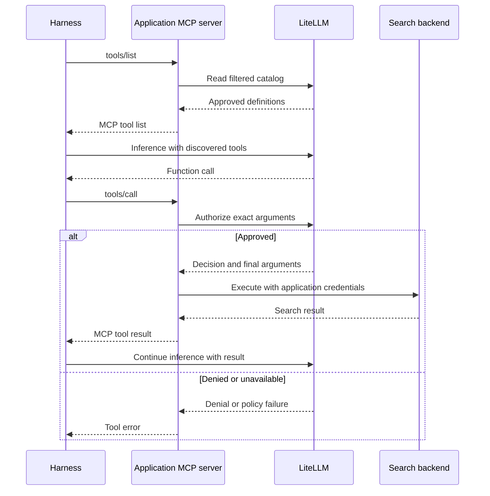

# LiteLLM v1.108.5 application-side MCP execution

Engineering handoff · 11 November 2026  
Target `BerriAI/litellm` tag `v1.108.5` · commit `2a61f2114d45016bae77930903e65172cd8e762c`. [LTS release][lts] · [Pinned source][tag]

[Architecture](#architecture-decision) · [Repositories](#repositories-and-dependencies) · [Client setup](#client-setup-and-schema-synchronization) · [Gateway changes](#gateway-implementation-on-the-pinned-tag) · [Verification](#verification-and-implementation-order) · [Runnable fixtures](#reproduce-the-stock-checks)

## Architecture decision

**LiteLLM owns the approved tool catalog and makes every authorization decision. The application’s internet-connected environment executes approved calls. Stock harnesses connect to an ordinary MCP server in that application environment.**

Mount `/mcp` in the existing application backend when possible. Where a backend cannot host it, run the same handlers as a sidecar or a local stdio process. A harness configures one standard MCP server entry. Its normal model connection can continue to use LiteLLM. For applications that already own their tool loop, the existing LiteLLM Chat Completions handoff is an optional entry point into the same authorization and execution flow. [MCP tool protocol][mcp-spec] · [MCP transports][mcp-transports] · [LiteLLM MCP configuration][mcp-config]

The network assumption is an existing approved path from the application to LiteLLM and an on-prem model path for inference. The gateway has zero public egress. Provider endpoints and credentials live with the application. Central input guardrails run before any outbound search. The application can also send the actual search result back through approved ingress for central screening when that policy is required.

| Component | Owns | Connects to |
| --- | --- | --- |
| LiteLLM Gateway | Canonical tool IDs, descriptions and schemas, caller grants, guardrails, model routing | The existing on-prem inference path |
| Application MCP server or owned tool loop | Caller mapping, tool-to-provider bindings, provider credentials, execution, and result handling | LiteLLM’s approved ingress and the application’s search backend |
| Codex, Claude Code, DeepSeek Harness, or another MCP host | Model/tool loop, tool discovery, invocation, and any host approval UI | The application MCP endpoint and its configured model endpoint |
| Search provider or existing search aggregator | Search execution and provider results | Reached from the application environment |

### Standard harness request flow



The model leg shows a harness configured to use LiteLLM for inference. A host may use a different model endpoint and still use the same MCP server. If result policy requires gateway inspection, the application adds that check before returning the tool result. A hosted harness must be able to reach the application MCP endpoint. `localhost` refers to the harness’s own network namespace. [MCP tool protocol][mcp-spec] · [Codex Cloud networking][codex-cloud]

### Why these boundaries

| Decision | Rationale and tradeoff |
| --- | --- |
| Expose MCP from the application environment | Standard `tools/list` and `tools/call` are sufficient for existing hosts. Placing the MCP server beside the app puts execution on the network that has the provider credential and internet access. The app must reach both LiteLLM and its search backend. |
| Publish schemas from the LiteLLM catalog | Permissions and definitions come from one authority. Provider package updates cannot silently change what the harness sees. A new tool or a breaking schema change still needs a compatible application binding. |
| Reuse LiteLLM admission and guardrails behind an internal authorization-only route | Central policy sees the exact arguments before egress and can block or rewrite them. One extra gateway round trip per call buys current policy enforcement and keeps the existing policy implementation authoritative. |
| Keep the public interface standard and the gateway patch opt-in | Harnesses can switch transport or model independently. The small private contract is between two services you control. Existing gateway-executed MCP servers keep their existing path. |
| Deploy the integration with the application | Both the application’s existing HTTP deployment and a sidecar can use public dependencies. Harness onboarding is a URL or launch command. You own the two small handlers and the provider binding, with no separate private Python package to distribute. |
| Keep output policy explicit | A pre-call check protects the provider boundary. Screening a result before returning it protects the harness and its downstream consumers. Screening a later inference message protects only the model input through that route. |

## Repositories and dependencies

| Repository or package | Use | Reason |
| --- | --- | --- |
| `BerriAI/litellm` at `v1.108.5` | Gateway baseline and the opt-in patch described below | The tag already has filtered MCP discovery, effective grants, parameter allowlists, MCP hooks and the Chat Completions handoff. Reuse those paths. [Source][tag] · [MCP REST docs][mcp-rest] |
| `modelcontextprotocol/python-sdk`, package `mcp` | Default implementation library for the application MCP endpoint. Use the low-level `Server` with `on_list_tools` and `on_call_tool`. Use `ClientSession.call_tool` only if the search backend speaks MCP. | The server accepts explicit JSON Schema objects, which preserves the centrally published contract. The SDK owns the MCP transport, negotiation, request decoding and response types. The fixtures used `mcp==2.3.0`. [Repository][mcp-python] · [Low-level server][sdk-low] · [Client transports][sdk-transport] |
| The application’s existing search aggregator or provider API | Preferred execution backend if an API already exists | A small fixed binding from canonical tool ID to existing HTTP or SDK operation avoids an extra MCP hop. A provider’s own MCP server can sit behind that binding when useful. |
| `tavily-ai/tavily-mcp`, npm package `tavily-mcp` | Optional example upstream when selecting Tavily | The published `0.2.22` stdio package advertised `tavily_search`, `tavily_extract`, `tavily_crawl`, `tavily_map` and `tavily_research` in the earlier discovery check. Publish only your reviewed contract, such as `web_search`, and bind it to the intended operation. [Repository][tavily] |
| `modelcontextprotocol/inspector` | Independent MCP discovery and call testing | Inspector `2.14.0` previously discovered a changed central description and exercised a connected-side endpoint. It helps distinguish wire interoperability from model behavior. [Repository][inspector] |
| `BerriAI/liteagents` and `litellm[mcp]` | Optional pieces for an application building its own tool loop | The helpers work with MCP sessions. The application still owns the mapping between the model call, the LiteLLM decision and the provider invocation. Stock harnesses already have their own loop. [LiteAgents MCP source][liteagents-mcp] · [LiteLLM MCP SDK source][litellm-mcp-sdk] |
| `deepseek-ai/deepseek-harness` | Client integration reference and interoperability test | Its public `@deepseek-ai/dsh-mcp-client` plug-in discovered and invoked the application MCP endpoint in the local fixture. [Plug-in configuration][deepseek-plugin] |

For the first implementation use the pinned LiteLLM checkout, the official MCP SDK, and one existing search backend. Start with a single `web_search` tool and an explicit binding. Pick transport and packaging based on where the harness runs. A Python service can mount the endpoint in its existing application. A service in another language can use the official SDK for that language with the same contracts. [MCP SDKs][mcp-sdks]

## Client setup and schema synchronization

| Client | Setup | Verification |
| --- | --- | --- |
| Codex CLI | `codex mcp add company-search --url <application-mcp-url>`. Use OAuth login or the documented `--bearer-token-env-var`. Configure LiteLLM’s Responses endpoint independently if it serves the model. | Codex 0.167.1 passed the live CLI fixture over Responses. The isolated test profile explicitly permitted only the read-only MCP fixture tool. [Codex MCP][codex-mcp] · [Codex with LiteLLM][codex-lite] |
| Claude Code | `claude mcp add --transport http company-search <application-mcp-url>`. Use `/mcp` for OAuth login or the documented headers for a provisioned credential. | Claude Code 2.1.322 passed the live CLI fixture over Messages. [Claude Code MCP][claude-mcp] |
| DeepSeek Harness | Configure the official MCP plug-in in `cordis.yml` with `transport: streamable-http`, `url` and the applicable authentication header. | The public plug-in `0.2.2-rc.1` passed the loopback interoperability fixture. Its default negotiation supports current and legacy revisions. [DeepSeek plug-in][deepseek-plugin] |
| OpenCode or VS Code | Register a remote HTTP MCP server with the URL and supported authentication. OpenCode V2 uses `mcp.servers`. | OpenCode V2 2.2.7 passed over Chat Completions with `codemode: false` for the fixture server. VS Code setup is documented. [OpenCode][opencode-mcp] · [VS Code][vscode-mcp] |
| Pi | `pi mcp add company_search --url <application-mcp-url> --bearer-token-env-var <ENV_VAR> --exposure direct`. | Pi 1.5.2 passed over Chat Completions using built-in MCP. [Pi MCP][pi-mcp] |
| An app using only a model SDK | Use a public MCP client in the tool loop or an agent runtime such as LiteAgents. The model SDK handles inference. | The custom Chat Completions fixture passed. DeepSeek’s hosted Responses API documents `type: "mcp"` as ignored. [Function calling][function-calling] · [DeepSeek Responses][deepseek-responses] |

**On `tools/list`**, authenticate the caller, then request `GET /mcp-rest/tools/list?server_id=<canonical-id>` using the corresponding LiteLLM identity and ordinary runtime filtering. Check both the HTTP result and the listing response for errors. Use the gateway’s canonical name, description and actual `inputSchema`. Copy supported tool metadata, and intersect the visible catalog with the application’s configured bindings. Use stable names and deterministic order. If the app serves multiple catalogs, map each public tool name explicitly to its canonical `(server_id, bare_tool_name)`. Avoid deriving routing or credentials from a tool description, argument, or model-chosen URL. [REST listing][rest-list] · [MCP tool definitions][mcp-spec]

Start with fresh gateway discovery for each new `tools/list` request. A host may cache the result for its current session. If active-session refresh is needed, support `notifications/tools/list_changed` when the host and negotiated protocol support it. The current revision delivers this over `subscriptions/listen`. Use reconnect or the host’s refresh control where subscriptions are unavailable. If a cache becomes necessary, key it by effective visibility and bound its freshness. A stale host list cannot grant an invocation because every call is authorized again. [MCP listing and notifications][mcp-spec]

## Gateway implementation on the pinned tag

### 1. Register the authoritative catalog

Keep the catalog with the gateway deployment. Stock LiteLLM can load a local OpenAPI JSON file via `spec_path` and project its operations into MCP tools. The simple search contract can start with a single operation. For a richer contract, inspect the actual served `inputSchema`. The LTS projection preserves basic types, descriptions and required fields, and places a JSON request body under `body`. Use a trusted gateway-side MCP catalog or a registry path that preserves native schemas when that projection cannot express the contract. [Local loader][spec-load] · [Registry setup][register-openapi] · [Discovery branch][list-openapi] · [Projection][openapi-projection]

```yaml
mcp_servers:
  search_catalog:
    server_id: "11111111-1111-4111-8111-111111111111"
    spec_path: /etc/litellm/search-catalog.json
    transport: http
    allow_all_keys: false
    allowed_tools: [web_search]
    allowed_params:
      web_search: [query]
    execution_mode: client  # Proposed field. Add it in the gateway patch.
```

```json
{
  "openapi": "3.0.3",
  "info": {"title": "Approved search catalog", "version": "1"},
  "paths": {
    "/search": {
      "get": {
        "operationId": "web_search",
        "summary": "Search the public web",
        "parameters": [
          {"name": "query", "in": "query", "required": true, "schema": {"type": "string"}}
        ],
        "responses": {"200": {"description": "Search results"}}
      }
    }
  }
}
```

Grant the application’s admitted key or team access using LiteLLM’s normal permission API. This is the relevant `object_permission` fragment. Confirm the effective grants in the target deployment because inheritance and applicable ceilings depend on the actual admitted identity. [Permission management][mcp-permissions] · [Effective grants][tool-grants]

```json
{
  "object_permission": {
    "mcp_servers": ["11111111-1111-4111-8111-111111111111"],
    "mcp_tool_permissions": {
      "11111111-1111-4111-8111-111111111111": ["web_search"]
    }
  }
}
```

### 2. Mark client-executed catalogs and block gateway dispatch

Add an opt-in `execution_mode: client` to `MCPServerConfig` and `MCPServer` and propagate it through registration and runtime copies. Leave the default as native gateway execution. Config-file registration is sufficient for the first deployment. Start by supporting this mode for the local `spec_path` catalog. This makes the catalog available without a vendor URL, vendor OAuth flow, or provider credential in LiteLLM. A stock `spec_path` entry can still reach the OpenAPI HTTP execution handler, so the file alone provides discovery. [Config model][mcp-server-config] · [Runtime model][mcp-server-type] · [Stock OpenAPI execution][execute-openapi]

Add the dispatch check at `operations.execute_mcp_tool` and `MCPServerManager.call_tool` or equivalent shared points that cover all paths. The checks must cover native MCP, REST, virtual tool dispatch and model-driven execution. In particular, `require_approval: "never"` on an inference request must be unable to cause native execution of a client-executed tool. Include startup, health, listing and telemetry in the gateway egress verification. [MCP and REST execution][execute-tool] · [Manager dispatch][manager-call] · [Model auto-execution][auto-exec]

### 3. Add the internal authorization-only operation

Add `POST /mcp-rest/tools/authorize` to the existing MCP REST router and put it in `LiteLLMRoutes.mcp_inference_routes`. This is a proposed private contract. A stock MCP host only calls its application MCP endpoint. Use the canonical server ID and bare tool name so model prefixes and display names never become policy inputs. The optional `tool_call_id` is for correlation. Derive the principal from authenticated context. [REST call route][rest-call] · [Route groups][routes] · [Acting identity][acting-user]

Example request

```json
{
  "server_id": "11111111-1111-4111-8111-111111111111",
  "name": "web_search",
  "arguments": {"query": "latest SGLang news"},
  "tool_call_id": "call-example-1"
}
```

Example approved response

```json
{
  "authorized": true,
  "authorization_id": "authz-example-1",
  "server_id": "11111111-1111-4111-8111-111111111111",
  "name": "web_search",
  "arguments": {"query": "latest SGLang news"},
  "tool_call_id": "call-example-1"
}
```

| Order | Reuse from LiteLLM | What to implement |
| --- | --- | --- |
| 1. Admit caller | `Depends(user_api_key_auth)`, `reject_disallowed_mcp_client`, `acting_user_auth` and catalog operation context | Enforce route access, applicable budget and client checks, and object-shaped arguments. Derive identity and guardrail scope from admission. A caller-provided team ID or username cannot establish authority. [Call entry][rest-call] · [Call preparation][rest-prepare] |
| 2. Resolve scope | `_resolve_allowed_mcp_servers_with_ip_filter` and effective auth context helpers | Resolve a permitted canonical server with existing IP and grant rules. Require client execution mode. If supporting toolsets, apply the same scoped permissions in listing and authorization. Keep the distinction between an absent tool grant and an explicit empty grant. [Server resolver][resolve-server] · [Server access][server-access] · [Tool grants][tool-grants] |
| 3. Require current membership | Existing catalog filters, pinned definitions and discovery guardrail outcome | Look up the tool in the current caller-visible local catalog. Deny missing, hidden, disabled and stale entries, including known aliases to denied tools. Carry the eligible schema and description into the call guardrail. Use any previous listed-tool cache entry as metadata and resolve eligibility from the current policy. [Catalog scan][catalog-scan] · [Listed metadata][listed-tool] |
| 4. Validate and guard | `pre_call_tool_check`, `validate_allowed_params`, a real `ProxyLogging` and native MCP request context | Validate proposed values against the schema and local bounds. Run the native check once. Preserve block, rewrite and server rate-limit semantics. Revalidate the final schema and parameter allowlist after rewriting. Use the original arguments only when the hook omits the `arguments` field. An intentional empty object is valid only when allowed by schema. [Native precheck][pre-check] · [Parameter check][allowed-params] · [Guardrail context][guardrail-context] |
| 5. Return a decision | Canonical server and tool identity, guardrail logging context | On explicit allow, return the final arguments and a decision identifier. Normalize schema failures, policy denials, limits and dependencies for the app. Keep gateway upstream credentials and hook-injected headers private. Log this as a policy decision and keep actual execution accounting with the app. |

The manager helper checks the tool and arguments. Server resolution and API admission must occur before it. With a real logging context it can invoke the selected MCP hooks and preserve guardrail monitoring. The native REST route uses `common_processing_pre_call_logic(..., skip_guardrails=True)` to prepare the context before invoking MCP-specific checks. Factor out the relevant preparation to preserve existing request, budget, and policy semantics. Avoid calling the native execution path or resolving upstream vendor credentials in the authorization route. [Call preparation][rest-prepare] · [Native precheck][pre-check]

Two LTS details matter. On `v1.108.5`, `allowed_tools` takes precedence when both server tool lists apply. Configure an explicit allowlist for this catalog and test overlaps if adding deny precedence to the new mode. `v1.109.0` includes fixes for allow/deny precedence and calls to tools hidden by discovery guardrails. On LTS, require explicit caller-visible catalog membership for each client-executed authorization. Runtime listing and native prechecks can each enforce server rate limits, so use the local policy lookup inside authorization without inadvertently charging a separate listing operation on every call. [LTS server policy][server-tool-policy] · [Stable release][stable] · [Discovery enforcement fix][discovery-fix] · [Listing limiter][rest-list-one] · [Rate limiter][rate-limit]

### 4. Wire the application MCP server

The official SDK’s low-level server needs two handlers. The `tools/list` handler follows the discovery contract above. The `tools/call` handler follows the steps below. The application-owned tool loop can share the same execution function. [SDK server API][sdk-low] · [MCP result contract][mcp-spec]

1. Authenticate the caller and look up the requested tool in the local binding map. Keep the map and provider settings in deployment configuration. The gateway owns the published tool definition. The application owns how an approved definition maps to a fixed backend operation.
2. Send the proposed arguments, canonical identity and correlation ID to LiteLLM. Require a successful response, affirmative `authorized` field, matching canonical identity and correctly shaped final arguments. A denial, timeout, unavailable policy service, malformed response or missing binding stops execution.
3. Invoke the configured backend using only the approved values. A fixed adapter can map names or field shapes to the provider contract. If the application needs to change the requested action or introduce a material argument, obtain a decision for the changed invocation. Keep network timeouts, cancellation, and provider errors distinct from policy denials.
4. Return a correctly shaped MCP result after any required output check. Expose a sanitized MCP tool error for a well-formed call that policy declines. Keep authorization IDs and provider error details in appropriate audit records. Separate transport authentication errors from argument-level denials.

**Identity at both connections.** For interactive Streamable HTTP, use the standard MCP OAuth flow where supported, including protected-resource metadata and audience validation. For headless hosts, use the documented bearer mechanism and issue credentials at the required scope. A token intended for the application MCP endpoint does not become a LiteLLM credential. Use an admitted gateway virtual key for the intended identity or a supported identity exchange. A single shared key applies that service’s policy to every call. Use caller-specific gateway identity where users need different grants or guardrails. For stdio, the launched process receives the required credentials from its deployment environment. [MCP authorization][mcp-auth] · [LiteLLM MCP access][mcp-access]

**Enforcement boundary.** The gateway controls the managed search flow because the application checks with it before using the managed provider credential. An independently credentialed application can call its own provider independently. If the guarantee must apply to all managed provider traffic, put the managed provider credential in the trusted execution component or use provider-side restrictions that enforce this boundary.

### 5. Apply output policy at the required point

| Guardrail | Placement for application execution | Consequence |
| --- | --- | --- |
| Catalog description and schema scanning | LiteLLM’s runtime listing and current eligibility lookup | A hidden tool is absent from discovery and ineligible for a new authorization, even if a host still displays it. [Catalog scan][catalog-scan] |
| `pre_mcp_call` | Authorization endpoint before the app can dispatch | Blocks or rewrites the exact proposed arguments. Put controls that must prevent outbound traffic here. [Precheck][pre-check] |
| `during_mcp_call` | Application call lifecycle, when needed | Native LiteLLM schedules this alongside its upstream call. It can affect the outcome after egress has started. [During hook][during-hook] · [Native dispatch][dispatch-concurrent] |
| LLM `pre_call` | LiteLLM inference request containing the tool result | Screens what enters the model through that path. It runs after the provider call. The fixture proved the Chat Completions case with `role: "tool"`. Test Responses and Messages separately if using them. [Content filter][content-filter] · [Lifecycle hooks][call-hooks] |
| MCP `post_mcp_call` parity | The application sends the actual `CallToolResult` to a gateway check before release | Protects the harness or user who receives the result. Use `ProxyLogging.post_mcp_call_hook` or an equivalent enforcing path with the correct policy context. Native logging callbacks have distinct error behavior. [Unified output hook][post-hook] · [Native callback][post-native] |

For model-input screening only, use a tested LLM `pre_call` rule on the actual tool-result content. The fixture used the built-in content filter locally in the gateway. The example below illustrates separate input and model-result stages. Set policy scope deliberately because a default-on LLM rule can also apply to other model input. A guardrail that requires a service must use an approved internal path consistent with the gateway’s network policy. [MCP guardrail config][guardrails] · [Built-in content filter][content-filter]

```yaml
guardrails:
  - guardrail_name: web-search-input
    litellm_params:
      guardrail: litellm_content_filter
      mode: pre_mcp_call
      default_on: true
      blocked_words:
        - keyword: blocked-input-fixture
          action: BLOCK
        - keyword: masked-input-fixture
          action: MASK
  - guardrail_name: model-tool-result-screening
    litellm_params:
      guardrail: litellm_content_filter
      mode: pre_call
      default_on: true
      blocked_words:
        - keyword: blocked-output-fixture
          action: BLOCK
```

If every consumer must receive a centrally screened result, add a private result check. Bind the result to the authenticated principal, authorized tool, decision ID and applicable call ID. Validate a size-bounded typed result and return the accepted or rewritten result to the application. The application releases only that result. If model admission must enforce this against a faulty application, also check the decision and result correlation at inference admission. A voluntary result endpoint leaves sequencing to the application. [MCP result contract][mcp-spec] · [Unified output hook][post-hook]

## Optional entry point for an application that owns the tool loop

On stock `v1.108.5` an application can request LiteLLM catalog projection through `POST /v1/chat/completions`. Include this in `tools` under the admitted LiteLLM identity. [Tool resolution][resolve-model-tools] · [Chat Completions handoff][chat-handoff]

```json
{
  "type": "mcp",
  "server_label": "search_catalog",
  "server_url": "litellm_proxy/mcp/search_catalog",
  "require_approval": "always"
}
```

LiteLLM filters the catalog, sends ordinary function definitions to the model and hands the resulting calls back to the app. `require_approval: "always"` selects the handoff on this path. The application then runs the separate per-call authorization step. The `execution_mode: client` dispatch check is still required so execution cannot be enabled by changing this request field. [Approval switch][approval-switch] · [Model auto-execution][auto-exec]

```json
{
  "id": "call-example-1",
  "type": "function",
  "function": {
    "name": "search_catalog-web_search",
    "arguments": "{\"query\":\"latest SGLang news\"}"
  }
}
```

Resolve the observed model-facing name through the explicit tool map. Assemble complete arguments before authorization, especially for streaming. Run the same decision and execution steps as the application MCP server. In the follow-up completion preserve the preceding assistant message with `tool_calls` and the exact call ID. The stock proof used non-streaming Chat Completions with a mock model. [Function calling][function-calling] · [Chat Completions handoff][chat-handoff]

```json
{
  "role": "tool",
  "tool_call_id": "call-example-1",
  "content": "Search results serialized as text"
}
```

## Operational behavior and upgrade path

- **Catalog changes.** Use compatible schema changes for existing tool names. For breaking changes, deploy the compatible binding first or use a new tool version. Discovery exposes the current visible catalog. On authorization, validate against the current eligible schema, even if the host is still using an older list. [MCP tool protocol][mcp-spec]
- **Policy and dependency failures.** Each new execution requires a current positive decision. Test revocation against the actual cache and database behavior across workers. Use bounded timeouts and distinguish policy denial from temporary unavailability. Keep the provider call count at zero on either outcome.
- **Retries and concurrency.** Correlate the model or MCP invocation, gateway decision and provider outcome. Deduplicate a repeated logical call where the app can recognize it. Keep principal and invocation scope in deduplication, and treat a provider timeout as potentially having executed. A policy allow is not a completed search or a billable provider result.
- **Portability.** Keep `tools/list` and `tools/call` on the public wire, and keep the internal decision API behind the app deployment. A harness upgrade, provider swap, or policy standard change then affects a specific connection. Verify negotiated MCP versions and real model tool calls when changing a host or SDK version. [MCP versioning][mcp-version]
- **Gateway upgrades.** Pin the release and run the acceptance tests before adopting a later gateway build. The prior source review covered `v1.109.0`, `v1.110.0-rc.1` and upstream snapshot `36160145`. Those changes include MCP catalog and policy improvements. The pinned patch remains the implementation baseline for this handoff. [Stable release][stable] · [Release candidate][rc]

### Alternatives and standards reviewed

| Option | Role in this deployment |
| --- | --- |
| Core MCP `2026-07-28` and current draft | A host calls the MCP server it selected. Sampling can request a model response from the client, with the requesting server handling the tool uses. No reverse tool dispatch is required when the configured MCP server already runs in the application environment. [Tools][mcp-spec] · [Sampling][mcp-sampling] · [Versioning][mcp-version] |
| Bidirectional Tools SEP-1006, asynchronous approval SEP-2848, and interceptors SEP-2624 | The bidirectional proposal is closed and dormant. The approval proposal waits and then executes at the same server. Interceptors are experimental and need support at the interception point. Keep these off the baseline dependency path. [SEP-1006][sep-bidi] · [Approval proposal][sep-approval] · [Interceptors][sep-interceptors] |
| OpenID AuthZEN and COAZ-MCP | AuthZEN Authorization API 1.0 is a final decision API. COAZ-MCP is a working-group draft mapping MCP tool arguments into decision requests. Consider that interface if independently implemented executors need interoperability. LiteLLM’s rewritten arguments and dispatch still need a contract. [AuthZEN][authzen] · [COAZ-MCP draft][coaz] |
| Server Cards, MCP Registry and enterprise-managed authorization | Server Cards and `server.json` help identify a server and publish connection or installation metadata. Permission-filtered schemas come from `tools/list`. Enterprise-managed authorization can help with identity-provider login where clients support it. The exact-call decision still belongs to the gateway. [Server Cards][server-cards] · [Registry][registry] · [Enterprise-managed authorization][enterprise-mcp] |
| ToolHive `v0.64.0` | Its HTTP authorizer can evaluate arguments and enforce a central allow/deny decision. Its stock overrides can change names, descriptions and annotations of provider tools. The required live LiteLLM schema and approved-argument rewrite still need integration. [Authorization][toolhive-auth] · [Tool overrides][toolhive-overrides] |
| MCP Runtime and Microsoft Agent Governance Toolkit | Useful references for policy enforcement around upstream MCP servers. Adding a gateway in front of the provider still leaves the integration with LiteLLM’s catalog and guardrail results to implement. [MCP Runtime][mcp-runtime] · [Agent Governance Toolkit][agt] |
| OpenAI Secure MCP Tunnel | An outbound connector for supported OpenAI products and private MCP servers. It uses an OpenAI-hosted connection flow. The application MCP endpoint works across vendors over an existing route. [Tunnel docs][tunnel-docs] · [Tunnel client][tunnel] |

## Verification and implementation order

### Evidence on the stock LTS checkout

The embedded Python fixtures and the DeepSeek plug-in fixture were rerun against the pinned checkout while preparing this handoff. All four runs passed using synthetic credentials and loopback services. The fixtures exercise stock gateway paths. The client-execution flag and production authorization-only and result-check contracts are proposed changes.

| Verified | Observed |
| --- | --- |
| Stock local catalog and owned-app model handoff | LiteLLM loaded an OpenAPI file without a provider URL. The mock model received the projected definition and returned `search_catalog-web_search`. The application invoked the stand-in MCP provider once and the original tool-call ID carried the result back into Chat Completions. |
| Native server and tool authorization | Fixture principals denied at server scope and at tool scope both received `403`. Neither reached the receipt handler. |
| Argument allowlist and input guardrails | A `region` key outside `allowed_params` returned `403`. A configured block returned `400` before receipt dispatch. A mask changed the argument to `find [KEYWORD_REDACTED]` and the receipt received the rewritten value. |
| Receipt and application result behavior | Native `post_mcp_call` blocked a marker in the receipt. The same marker in an app-submitted `role: "tool"` message reached the mock model when only MCP-mode guards were configured. With LLM `pre_call` enabled, the tool message returned `400` before the model received it. |
| Standard DeepSeek MCP plug-in | `0.2.2-rc.1` registered the gateway’s schema over Streamable HTTP. LiteLLM returned `200` for an allowed call and `403` for an argument denial. The provider ran once. The plug-in discovered a changed description after reconnecting to the same endpoint. |

The handoff and DeepSeek fixtures use a test master key. The policy fixture injects test identities at the FastAPI dependency boundary, then exercises the real policy and guardrail paths. The DeepSeek fixture calls the published plug-in through a small registration context and uses a receipt-only local MCP handler. It verifies discovery on reconnect, and the push-notification path remains a staging check. Live provider calls, real virtual-key issuance, database-backed identity inheritance, OAuth, hosted network paths and production model streaming also require staging verification.

### Cross-harness authorization and guardrail verification

The same authenticated application MCP endpoint passed four consecutive tool-call cases in five clients against LiteLLM `v1.108.5`. Codex `0.167.1` used LiteLLM’s Responses endpoint. Claude Code `2.1.322` used Messages. OpenCode V2 `2.2.7` and Pi `1.5.2` used Chat Completions. The Python MCP SDK `2.3.0` invoked the tools directly.

| Case | Gateway outcome | Application and harness outcome |
| --- | --- | --- |
| Normal search | `200` with approved arguments | The provider received the original query once and the result returned to the caller. |
| Tool permission removed after discovery | `403` from the native key/team tool permission check | The caller received a gateway authorization error. The provider received zero HTTP requests for this call. |
| Request matched the configured `pre_mcp_call` BLOCK rule | `400` with the name of the blocking guardrail | The application returned an MCP tool result with `isError: true`. The provider received zero HTTP requests for this call. |
| Request matched the configured MASK rule | `200` with rewritten arguments | The provider received only the approved `find [KEYWORD_REDACTED]` query and the result returned to the caller. |

Each CLI returned all four results to the mock model in the original call order and with the matching tool call IDs. The Python client asserted the MCP error flag directly and separately confirmed that a request without the application bearer was rejected with `401` before catalog lookup. Provider HTTP instrumentation included session and discovery requests, as well as calls. In each run only the allowed and masked invocations reached the provider listener. [MCP tool errors][mcp-spec] · [Guardrail modes][guardrails]

For a synchronous stop, the application waits for LiteLLM’s affirmative decision before opening the provider connection. The blocking response travels back to the harness on the outstanding `tools/call`. Use a sanitized, actionable message such as `Gateway guardrail stopped this call`. Keep structured reason codes in the production decision API so the app can distinguish a revoked grant, a guardrail block, and a service failure. The guarantee applies to calls routed through this application MCP endpoint. Harness-native shell or file tools use the harness’s own controls. An action already sent to a provider requires a separate cancellation mechanism and can already have taken effect. [Native precheck][pre-check] · [Concurrent native dispatch][dispatch-concurrent]

The fixture used an isolated Linux work directory, deterministic mock model streams, a loopback provider, and synthetic gateway identities. It exercised stock LiteLLM’s REST receipt path and real key/team grant and input guardrail code. The blocking rule used a harmless configured marker to verify enforcement. Production harm detection rules, OAuth and database-backed grant revocation, the proposed authorization-only route, and live provider behavior need their own verification.

To reproduce the same cases, use the loopback receipt setup below with `pre_mcp_call` BLOCK and MASK test rules. Keep the approved tool visible during discovery, then remove its grant from the fixture principal just before the second invocation. Restore the grant before the guardrail case. Drive the four inputs through the same harness session and assert the gate status, call ID, returned result, and per-call provider HTTP count. For Codex headless runs, explicitly permit the fixture’s read-only `web_search` with `mcp_servers.company_search.tools.web_search.approval_mode = "approve"` when local policy requires it. Use `codemode: false` for OpenCode V2 and `--exposure direct` for Pi to expose the test tool directly. These host settings select the tool and approval behavior. LiteLLM still makes the decision for every call. [Codex MCP][codex-mcp] · [OpenCode MCP][opencode-mcp] · [Pi MCP][pi-mcp]

### Stock pilot using a receipt

For a zero-patch pilot, register a trusted loopback or same-deployment catalog with a receipt-only `tools/call` handler. The application calls stock `POST /mcp-rest/tools/call` and dispatches only on a matching positive receipt with valid `structuredContent`. Check the HTTP status, `isError` and approved arguments. The stock route counts this as a tool execution, and its post-call guardrail sees the receipt. Use this to reproduce the checks. The production design replaces the receipt with an explicit authorization operation and keeps actual execution accounting in the application. [Stock REST call][rest-call] · [Native result logging][post-log]

### Implementation sequence

1. **Start with the pinned tag and one tool.** Run the fixtures, define the canonical `web_search` schema and choose the app’s fixed search binding. Confirm which app-to-gateway identity will carry production permissions.
2. **Implement the gateway changes.** Add the local-catalog execution mode, dispatch checks and private authorization route. Reuse native preparation and policy checks. Extend the pinned integration suite where the new behavior is exercised.
3. **Mount the application endpoint.** Implement discovery and invocation with the official SDK. Use one standard MCP host and the real application-to-gateway credential in staging. Add optional Chat Completions handoff only for applications that use it.
4. **Enable the required result policy and validate the production path.** Check real egress, caller permissions, guardrails, rate limits and call correlation in staging before promoting the configuration.

### Acceptance tests for the implementation

| Case | Required observation |
| --- | --- |
| Standard and custom host flows | The standard host lists and calls the application MCP server. The optional owned-app flow preserves the model call ID. In each flow only the app contacts the search backend, and an allowed logical call executes once. |
| Real caller admission | Use the intended production-style keys or SSO in staging. Verify API route scope, server and tool grants, team inheritance and applicable ceilings. Compare two identities with distinct visibility and revoke one across workers. |
| Current catalog | Unknown, hidden, disabled and stale entries deny. Known aliases cannot expand grants. A compatible catalog update changes the next eligible discovery and authorization without reinstalling the client. |
| Exact argument and input policy | Unknown parameters, malformed values and blocked content produce zero provider calls. Rewrites reach the provider as approved. A failed rewrite validation or required guardrail failure stops the call. |
| Gateway egress boundary | Native MCP JSON-RPC, REST calls, virtual tools and model auto-execution cannot dispatch a client-executed tool. Include model requests asking for auto-execution. Native gateway-executed tools still work, and gateway network traces show zero public provider connections. |
| Result policy | Verify the selected policy with text and structured outputs and with error results when supported. For central MCP result enforcement, only the approved result is released. |
| Failure and accounting | Exercise gateway and provider timeouts, denied and concurrent calls, and retry handling. Distinguish policy decisions, provider invocations, and final outcomes in audit and accounting. |

The pinned MCP test suite includes `test_mcp_access_matrix.py` for grants, `test_mcp_accounting_guardrails.py` for policy and accounting, `test_mcp_listed_tool_metadata.py` for catalog context, and `test_mcp_llm_endpoints.py` for model-facing behavior. Follow the tagged integration harness for database-backed checks. [MCP tests][integration-tests] · [Integration harness][test-harness]

## Reproduce the stock checks

Save the four code blocks below as `handoff_smoke.py`, `policy_smoke.py`, `deepseek_smoke.py` and `deepseek_client/check.mjs` in a fixture directory outside the checkout. The fixture files start only loopback services and use synthetic credentials. Use a test environment. The policy fixture’s authentication override is confined to that fixture.

Run from the checkout and set `FIXTURE_DIR` to the absolute fixture directory. The expected Git commit is `2a61f2114d45016bae77930903e65172cd8e762c`. `PYTHONPATH` imports the pinned checkout while the pinned wheel supplies dependencies. The test environment used Python 3.12 and Node.js 24.22.1. It resolved `httpx 0.28.1`, `httpx2 2.16.0`, `openai 3.49.0`, `fastapi 0.162.4`, `starlette 1.10.0`, `uvicorn 0.54.0`, `PyYAML 6.0.3` and `pydantic 2.14.3`. Package installation can use an approved mirror. [Tagged dependencies][pyproject]

```bash
git clone --depth 1 --branch v1.108.5 https://github.com/BerriAI/litellm.git
cd litellm
git rev-parse HEAD
python3.12 -m venv .venv
.venv/bin/python -m pip install 'litellm[proxy]==1.108.5' 'mcp==2.3.0'

FIXTURE_DIR=/absolute/path/to/fixtures
npm install --prefix "$FIXTURE_DIR/deepseek_client" --no-audit --no-fund \
  --ignore-scripts '@deepseek-ai/dsh-mcp-client@0.2.2-rc.1'

(
  unset ALL_PROXY HTTPS_PROXY HTTP_PROXY all_proxy https_proxy http_proxy
  export PYTHONPATH="$PWD"
  export LITELLM_LOCAL_MODEL_COST_MAP=True
  export LITELLM_TELEMETRY=False
  export LITELLM_DONT_SHOW_FEEDBACK_BOX=true

  .venv/bin/python "$FIXTURE_DIR/handoff_smoke.py"
  .venv/bin/python "$FIXTURE_DIR/policy_smoke.py"
  .venv/bin/python "$FIXTURE_DIR/policy_smoke.py" --model-pre-call
  .venv/bin/python "$FIXTURE_DIR/deepseek_smoke.py"
)
```

The policy tests intentionally generate `403` and `400` responses. They assert whether a call reached the receipt handler or mock model. The DeepSeek fixture asserts the `200`/`403` decision sequence, one provider invocation and the changed schema description on a fresh connection.

### handoff_smoke.py

```python
import asyncio
import json
import os
import socket
import tempfile
from contextlib import asynccontextmanager
from pathlib import Path

import httpx
import httpx2
import uvicorn
import yaml
from mcp import ClientSession
from mcp.client.streamable_http import streamable_http_client
from mcp.server import Server
from mcp.server.streamable_http_manager import StreamableHTTPSessionManager
from mcp.types import CallToolResult, ListToolsResult, TextContent, Tool
from starlette.applications import Starlette
from starlette.responses import JSONResponse
from starlette.routing import Mount, Route

from litellm.proxy.proxy_server import app as gateway

schema = {"type": "object", "properties": {"query": {"type": "string"}}, "required": ["query"]}
provider_requests = []
executions = []
received_tools = []

async def provider_list(context, params):
    return ListToolsResult(tools=[Tool(name="tavily_search", input_schema=schema)])

async def provider_search(context, params):
    executions.append((params.name, params.arguments))
    return CallToolResult(content=[TextContent(type="text", text=f"mock web result for {params.arguments['query']}")])

provider = Server("stand-in-search-provider", on_list_tools=provider_list, on_call_tool=provider_search)
provider_manager = StreamableHTTPSessionManager(provider, stateless=True, json_response=True)

async def only_app_can_access_provider(scope, receive, send):
    headers = dict(scope.get("headers", ()))
    provider_requests.append(headers.get(b"authorization"))
    if headers.get(b"authorization") != b"Bearer local-app-only":
        await JSONResponse({"detail": "application credential required"}, status_code=401)(scope, receive, send)
        return
    await provider_manager.handle_request(scope, receive, send)

@asynccontextmanager
async def provider_lifespan(app):
    async with provider_manager.run():
        yield

provider_app = Starlette(routes=[Mount("/mcp", app=only_app_can_access_provider)], lifespan=provider_lifespan)

async def fake_model(request):
    data = await request.json()
    if data["messages"][-1]["role"] == "tool":
        result = data["messages"][-1]
        assert result["tool_call_id"] == "call-offline-catalog", result
        message = {"role": "assistant", "content": result["content"]}
        reason = "stop"
    else:
        received_tools.extend(data["tools"])
        function = data["tools"][0]["function"]
        assert function["description"] == "Search the public web using the approved catalog definition"
        assert function["parameters"]["properties"]["query"]["type"] == "string"
        assert function["parameters"]["required"] == ["query"]
        message = {"role": "assistant", "tool_calls": [{
            "id": "call-offline-catalog", "type": "function",
            "function": {"name": function["name"], "arguments": json.dumps({"query": "latest SGLang news"})},
        }]}
        reason = "tool_calls"
    return JSONResponse({
        "id": "chatcmpl-local-proof", "object": "chat.completion", "created": 0, "model": "proof",
        "choices": [{"index": 0, "message": message, "finish_reason": reason}],
        "usage": {"prompt_tokens": 1, "completion_tokens": 1, "total_tokens": 2},
    })

model_app = Starlette(routes=[Route("/v1/chat/completions", fake_model, methods=["POST"])])

async def run():
    with socket.socket() as model_socket, socket.socket() as provider_socket, tempfile.TemporaryDirectory() as temp:
        model_socket.bind(("127.0.0.1", 0))
        provider_socket.bind(("127.0.0.1", 0))
        model_base = f"http://127.0.0.1:{model_socket.getsockname()[1]}"
        provider_base = f"http://127.0.0.1:{provider_socket.getsockname()[1]}"
        processes = [
            (uvicorn.Server(uvicorn.Config(model_app, log_level="error")), model_socket),
            (uvicorn.Server(uvicorn.Config(provider_app, log_level="error")), provider_socket),
        ]
        tasks = [asyncio.create_task(server.serve(sockets=[listener])) for server, listener in processes]
        try:
            async with asyncio.timeout(8):
                while not all(server.started for server, _ in processes):
                    await asyncio.sleep(0.02)
            spec = {
                "openapi": "3.0.3", "info": {"title": "Approved search catalog", "version": "1"},
                "paths": {"/search": {"get": {
                    "operationId": "web_search",
                    "summary": "Search the public web using the approved catalog definition",
                    "parameters": [{"name": "query", "in": "query", "required": True, "schema": {"type": "string"}}],
                    "responses": {"200": {"description": "Search results"}},
                }}},
            }
            spec_path = Path(temp) / "search-catalog.json"
            spec_path.write_text(json.dumps(spec))
            config = {
                "model_list": [{"model_name": "proof", "litellm_params": {
                    "model": "openai/proof", "api_base": f"{model_base}/v1", "api_key": "mock-internal-model",
                }}],
                "mcp_servers": {"search_catalog": {
                    "spec_path": str(spec_path), "transport": "http", "allowed_tools": ["web_search"],
                }},
                "general_settings": {"master_key": "sk-local-proof"},
            }
            config_path = Path(temp) / "config.yaml"
            config_path.write_text(yaml.safe_dump(config))
            os.environ["CONFIG_FILE_PATH"] = str(config_path)

            async with gateway.router.lifespan_context(gateway):
                async with httpx.AsyncClient(
                    transport=httpx.ASGITransport(app=gateway), base_url="http://gateway.local",
                    headers={"Authorization": "Bearer sk-local-proof"},
                ) as app_to_gateway:
                    messages = [{"role": "user", "content": "What is the latest SGLang news?"}]
                    body = {"model": "proof", "messages": messages, "tools": [{
                        "type": "mcp", "server_label": "search_catalog",
                        "server_url": "litellm_proxy/mcp/search_catalog", "require_approval": "always",
                    }]}
                    first = await app_to_gateway.post("/v1/chat/completions", json=body)
                    assert first.status_code == 200, first.text
                    assistant = first.json()["choices"][0]["message"]
                    call = assistant["tool_calls"][0]
                    assert len(received_tools) == 1 and provider_requests == [] and executions == []
                    tool_name = call["function"]["name"]
                    assert tool_name == "search_catalog-web_search", tool_name
                    upstream_names = {"search_catalog-web_search": "tavily_search"}
                    arguments = json.loads(call["function"]["arguments"])

                    async with httpx2.AsyncClient(headers={"Authorization": "Bearer local-app-only"}, trust_env=False) as egress_http:
                        async with streamable_http_client(f"{provider_base}/mcp/", http_client=egress_http) as streams:
                            async with ClientSession(streams[0], streams[1]) as session:
                                await session.initialize()
                                result = await session.call_tool(upstream_names[tool_name], arguments)
                    assert not result.is_error and executions == [("tavily_search", arguments)], executions
                    assert provider_requests and set(provider_requests) == {b"Bearer local-app-only"}, provider_requests
                    followup = await app_to_gateway.post("/v1/chat/completions", json={
                        **body, "messages": [*messages, {"role": "assistant", "tool_calls": [call]},
                        {"role": "tool", "tool_call_id": call["id"], "content": result.content[0].text}],
                    })
                    assert followup.status_code == 200, followup.text
                    assert followup.json()["choices"][0]["message"]["content"] == "mock web result for latest SGLang news"
                    print("PASS: LiteLLM v1.108.5 loaded local OpenAPI file without a provider URL; model returned search_catalog-web_search; application called separate MCP provider once and returned result using tool_call_id")
        finally:
            for server, _ in processes:
                server.should_exit = True
            await asyncio.gather(*tasks)

asyncio.run(run())
```

### policy_smoke.py

```python
import asyncio
import os
import socket
import sys
import tempfile
from contextlib import asynccontextmanager
from pathlib import Path

import httpx
import uvicorn
import yaml
from fastapi import HTTPException, Request
from mcp.server import Server
from mcp.server.streamable_http_manager import StreamableHTTPSessionManager
from mcp.types import CallToolResult, ListToolsResult, TextContent, Tool
from starlette.applications import Starlette
from starlette.responses import JSONResponse
from starlette.routing import Mount, Route

from litellm.proxy._types import LiteLLM_ObjectPermissionTable
from litellm.proxy.auth.user_api_key_auth import user_api_key_auth
from litellm.proxy.proxy_server import app as gateway
from litellm.types.proxy.auth.user_api_key_auth import UserAPIKeyAuth
from litellm.types.proxy.auth.user_roles import LitellmUserRoles

SERVER_ID = "11111111-1111-4111-8111-111111111111"
BLOCK_INPUT = "blocked-input-fixture"
MASK_INPUT = "masked-input-fixture"
BLOCK_OUTPUT = "blocked-output-fixture"
MODEL_PRE_CALL = "--model-pre-call" in sys.argv
receipt_calls = []
model_tool_results = []

async def list_catalog(context, params):
    schema = {
        "type": "object",
        "properties": {"query": {"type": "string"}, "region": {"type": "string"}},
        "required": ["query"],
    }
    return ListToolsResult(tools=[Tool(name="web_search", description="Search the public web", input_schema=schema)])

async def issue_receipt(context, params):
    receipt_calls.append(dict(params.arguments))
    text = BLOCK_OUTPUT if params.arguments["query"] == "test receipt output" else "approval receipt"
    return CallToolResult(
        content=[TextContent(type="text", text=text)],
        structured_content={"allow": True, "arguments": params.arguments},
    )

catalog = Server("catalog-receipt", on_list_tools=list_catalog, on_call_tool=issue_receipt)
manager = StreamableHTTPSessionManager(catalog, stateless=True, json_response=True)

@asynccontextmanager
async def lifespan(app):
    async with manager.run():
        yield

async def echo_model(request):
    data = await request.json()
    model_tool_results.append(data["messages"][-1]["content"])
    return JSONResponse({
        "id": "chatcmpl-policy-fixture", "object": "chat.completion", "created": 0, "model": "proof",
        "choices": [{"index": 0, "message": {"role": "assistant", "content": "received"}, "finish_reason": "stop"}],
        "usage": {"prompt_tokens": 1, "completion_tokens": 1, "total_tokens": 2},
    })

local_app = Starlette(
    routes=[Mount("/catalog", app=manager.handle_request), Route("/v1/chat/completions", echo_model, methods=["POST"])],
    lifespan=lifespan,
)

async def fixture_auth(request: Request) -> UserAPIKeyAuth:
    profile = request.headers.get("authorization", "").removeprefix("Bearer ")
    if profile not in {"allow", "deny-server", "deny-tool"}:
        raise HTTPException(status_code=401, detail="Missing test credential")
    servers = ["no-mcp-servers"] if profile == "deny-server" else [SERVER_ID]
    tools = [] if profile == "deny-tool" else ["web_search"]
    return UserAPIKeyAuth(
        api_key=f"fixture-{profile}",
        user_id=f"user-{profile}",
        user_role=LitellmUserRoles.INTERNAL_USER,
        object_permission=LiteLLM_ObjectPermissionTable(
            object_permission_id=f"permission-{profile}",
            mcp_servers=servers,
            mcp_tool_permissions={SERVER_ID: tools},
        ),
    )

def policy_guardrail(name, mode, rules):
    return {"guardrail_name": name, "litellm_params": {
        "guardrail": "litellm_content_filter", "mode": mode, "default_on": True,
        "blocked_words": [{"keyword": keyword, "action": action} for keyword, action in rules],
    }}

async def exercise(client):
    async def call(profile, arguments):
        return await client.post("/mcp-rest/tools/call", headers={"Authorization": f"Bearer {profile}"}, json={
            "server_id": SERVER_ID, "name": "web_search", "arguments": arguments,
        })

    denied_server = await call("deny-server", {"query": "ordinary search"})
    assert denied_server.status_code == 403 and "access_denied" in denied_server.text, denied_server.text
    denied_tool = await call("deny-tool", {"query": "ordinary search"})
    assert denied_tool.status_code == 403 and "key/team" in denied_tool.text, denied_tool.text
    disallowed_param = await call("allow", {"query": "ordinary search", "region": "example"})
    assert disallowed_param.status_code == 403 and "Parameters" in disallowed_param.text, disallowed_param.text
    blocked_input = await call("allow", {"query": BLOCK_INPUT})
    assert blocked_input.status_code == 400 and blocked_input.json()["detail"]["guardrail_name"] == "fixture-input", blocked_input.text
    assert receipt_calls == [], receipt_calls

    rewritten = await call("allow", {"query": f"find {MASK_INPUT}"})
    assert rewritten.status_code == 200, rewritten.text
    masked = rewritten.json()["structuredContent"]["arguments"]["query"]
    assert masked == "find [KEYWORD_REDACTED]" and receipt_calls == [{"query": masked}], (masked, receipt_calls)

    blocked_receipt = await call("allow", {"query": "test receipt output"})
    assert blocked_receipt.status_code == 400 and blocked_receipt.json()["detail"]["guardrail_name"] == "fixture-output", blocked_receipt.text
    assert len(receipt_calls) == 2 and receipt_calls[-1]["query"] == "test receipt output", receipt_calls

    continued = await client.post("/v1/chat/completions", headers={"Authorization": "Bearer allow"}, json={
        "model": "proof",
        "messages": [
            {"role": "user", "content": "Search the web"},
            {"role": "assistant", "tool_calls": [{"id": "call-policy-fixture", "type": "function", "function": {
                "name": "web_search", "arguments": '{"query":"ordinary search"}',
            }}]},
            {"role": "tool", "tool_call_id": "call-policy-fixture", "content": BLOCK_OUTPUT},
        ],
    })
    if MODEL_PRE_CALL:
        assert continued.status_code == 400 and model_tool_results == [], continued.text
        assert "fixture-model-input" in continued.text, continued.text
    else:
        assert continued.status_code == 200 and model_tool_results == [BLOCK_OUTPUT], continued.text
    assert len(receipt_calls) == 2, receipt_calls

    print("PASS: scoped mock principals denied at server and tool levels, allowed_params denied, pre_mcp_call blocked and masked arguments")
    print("PASS: post_mcp_call blocked the receipt after dispatch")
    if MODEL_PRE_CALL:
        print("PASS: configured model pre_call content filter blocked the tool result before inference")
    else:
        print("PASS: with only MCP guardrails configured, the tool message reached the model")

async def main():
    with socket.socket() as listener, tempfile.TemporaryDirectory() as temp:
        listener.bind(("127.0.0.1", 0))
        local_url = f"http://127.0.0.1:{listener.getsockname()[1]}"
        server = uvicorn.Server(uvicorn.Config(local_app, log_level="error"))
        task = asyncio.create_task(server.serve(sockets=[listener]))
        try:
            async with asyncio.timeout(8):
                while not server.started:
                    await asyncio.sleep(0.02)
            config = {
                "model_list": [{"model_name": "proof", "litellm_params": {
                    "model": "openai/proof", "api_base": f"{local_url}/v1", "api_key": "mock-internal-model",
                }}],
                "mcp_servers": {"search_catalog": {
                    "server_id": SERVER_ID, "url": f"{local_url}/catalog/", "transport": "http",
                    "allowed_tools": ["web_search"], "allowed_params": {"web_search": ["query"]},
                }},
                "general_settings": {"master_key": "sk-local-proof"},
                "guardrails": [
                    policy_guardrail("fixture-input", "pre_mcp_call", [(BLOCK_INPUT, "BLOCK"), (MASK_INPUT, "MASK")]),
                    policy_guardrail("fixture-output", "post_mcp_call", [(BLOCK_OUTPUT, "BLOCK")]),
                ],
            }
            if MODEL_PRE_CALL:
                config["guardrails"].append(
                    policy_guardrail("fixture-model-input", "pre_call", [(BLOCK_OUTPUT, "BLOCK")])
                )
            config_path = Path(temp) / "config.yaml"
            config_path.write_text(yaml.safe_dump(config))
            os.environ["CONFIG_FILE_PATH"] = str(config_path)
            gateway.dependency_overrides[user_api_key_auth] = fixture_auth
            async with gateway.router.lifespan_context(gateway):
                async with httpx.AsyncClient(
                    transport=httpx.ASGITransport(app=gateway), base_url="http://gateway.local",
                ) as client:
                    await exercise(client)
        finally:
            gateway.dependency_overrides.pop(user_api_key_auth, None)
            server.should_exit = True
            await task

asyncio.run(main())
```

### deepseek_smoke.py

```python
import asyncio
import os
import socket
import tempfile
from contextlib import asynccontextmanager
from pathlib import Path

import httpx
import httpx2
import uvicorn
import yaml
from mcp import ClientSession
from mcp.client.streamable_http import streamable_http_client
from mcp.server import Server
from mcp.server.streamable_http_manager import StreamableHTTPSessionManager
from mcp.types import CallToolResult, ListToolsResult, TextContent, Tool
from starlette.applications import Starlette
from starlette.responses import JSONResponse
from starlette.routing import Mount

from litellm.proxy.proxy_server import app as gateway


CATALOG_ID = "11111111-1111-4111-8111-111111111111"
APP_TOKEN = "spike-local-only-mcp"
CATALOG_KEY = "sk-spike-local-only"
SCHEMA = {
    "type": "object",
    "properties": {"query": {"type": "string"}, "region": {"type": "string"}},
    "required": ["query"],
    "additionalProperties": False,
}
state = {"receipt": [], "provider": [], "decision_statuses": [], "description": "Gateway-owned web search"}


async def catalog_list(context, params):
    return ListToolsResult(tools=[Tool(name="web_search", input_schema=SCHEMA, description=state["description"])])


async def authorize_receipt(context, params):
    state["receipt"].append(params.arguments)
    return CallToolResult(content=[], structured_content={"allow": True, "arguments": params.arguments})


async def provider_list(context, params):
    return ListToolsResult(tools=[Tool(name="search_provider", input_schema=SCHEMA)])


async def provider_search(context, params):
    state["provider"].append(params.arguments)
    return CallToolResult(content=[TextContent(type="text", text="spike-search-result")])


async def connector_list(context, params):
    async with httpx.AsyncClient(trust_env=False, headers={"Authorization": f"Bearer {CATALOG_KEY}"}) as client:
        listed = await client.get(f"{state['gateway']}/mcp-rest/tools/list", params={"server_id": CATALOG_ID})
    listed.raise_for_status()
    response = listed.json()
    assert response["error"] is None, response
    return ListToolsResult(tools=[
        Tool(name=item["name"], description=item["description"], input_schema=item["inputSchema"])
        for item in response["tools"]
    ])


async def connector_call(context, params):
    assert params.name == "web_search", params.name
    async with httpx.AsyncClient(trust_env=False, headers={"Authorization": f"Bearer {CATALOG_KEY}"}) as client:
        decision = await client.post(f"{state['gateway']}/mcp-rest/tools/call", json={
            "server_id": CATALOG_ID, "name": params.name, "arguments": params.arguments,
        })
    state["decision_statuses"].append(decision.status_code)
    if not decision.is_success:
        return CallToolResult(is_error=True, content=[TextContent(type="text", text="spike-central-denial")])
    receipt = decision.json()["structuredContent"]
    assert receipt["allow"] is True, receipt
    async with httpx2.AsyncClient(trust_env=False) as transport_http:
        async with streamable_http_client(state["provider_url"], http_client=transport_http) as transport:
            async with ClientSession(transport[0], transport[1]) as provider:
                await provider.initialize()
                return await provider.call_tool("search_provider", receipt["arguments"])


def manager(name, list_tools, call_tool):
    return StreamableHTTPSessionManager(
        Server(name, on_list_tools=list_tools, on_call_tool=call_tool), stateless=True, json_response=True,
    )


catalog = manager("lite-catalog", catalog_list, authorize_receipt)
connector = manager("application-search", connector_list, connector_call)
provider = manager("stand-in-search", provider_list, provider_search)


async def connector_auth(scope, receive, send):
    if dict(scope.get("headers", ())).get(b"authorization") != f"Bearer {APP_TOKEN}".encode():
        await JSONResponse({"detail": "unauthenticated fixture"}, status_code=401)(scope, receive, send)
        return
    await connector.handle_request(scope, receive, send)


@asynccontextmanager
async def peers_lifespan(app):
    async with catalog.run(), connector.run(), provider.run():
        yield


peers = Starlette(routes=[
    Mount("/catalog", app=catalog.handle_request), Mount("/mcp", app=connector_auth),
    Mount("/provider", app=provider.handle_request),
], lifespan=peers_lifespan)


async def run_deepseek(connector_url, mode):
    runner = Path(__file__).resolve().parent / "deepseek_client" / "check.mjs"
    process = await asyncio.create_subprocess_exec(
        "node", runner, connector_url, APP_TOKEN, state["description"], mode,
        env={"PATH": os.environ["PATH"]},
        stdout=asyncio.subprocess.PIPE, stderr=asyncio.subprocess.PIPE,
    )
    try:
        stdout, stderr = await asyncio.wait_for(process.communicate(), 15)
    except asyncio.TimeoutError:
        process.kill()
        await process.wait()
        raise
    assert process.returncode == 0, (process.returncode, stdout[-3000:], stderr[-4000:])


async def main():
    with socket.socket() as peer_socket, socket.socket() as gateway_socket, tempfile.TemporaryDirectory() as temp:
        peer_socket.bind(("127.0.0.1", 0))
        gateway_socket.bind(("127.0.0.1", 0))
        peer_url = f"http://127.0.0.1:{peer_socket.getsockname()[1]}"
        state["gateway"] = f"http://127.0.0.1:{gateway_socket.getsockname()[1]}"
        state["provider_url"] = f"{peer_url}/provider/"
        config = {
            "model_list": [{"model_name": "proof", "litellm_params": {
                "model": "openai/proof", "api_base": f"{peer_url}/model/v1", "api_key": "local-model-only",
            }}],
            "mcp_servers": {"search_catalog": {"server_id": CATALOG_ID, "url": f"{peer_url}/catalog/",
                "transport": "http", "allowed_tools": ["web_search"], "allowed_params": {"web_search": ["query"]}}},
            "general_settings": {"master_key": CATALOG_KEY},
        }
        config_path = Path(temp, "config.yaml")
        config_path.write_text(yaml.safe_dump(config))
        os.environ["CONFIG_FILE_PATH"] = str(config_path)
        servers = [(uvicorn.Server(uvicorn.Config(peers, log_level="error")), peer_socket),
                   (uvicorn.Server(uvicorn.Config(gateway, log_level="error")), gateway_socket)]
        tasks = [asyncio.create_task(server.serve(sockets=[listener])) for server, listener in servers]
        try:
            async with asyncio.timeout(8):
                while not all(server.started for server, _ in servers):
                    await asyncio.sleep(0.02)
            await run_deepseek(f"{peer_url}/mcp/", "invoke")
            assert state["decision_statuses"] == [200, 403], state
            assert state["provider"] == [{"query": "public example"}], state
            state["description"] = "Gateway-owned web search v2"
            await run_deepseek(f"{peer_url}/mcp/", "rediscover")
            print("PASS: Official DeepSeek Harness MCP plugin 0.2.2-rc.1 discovered the gateway schema, received a provider result for allow, received an MCP error for deny, and discovered a changed description on a fresh connection.")
        finally:
            for server, _ in servers:
                server.should_exit = True
            await asyncio.gather(*tasks)


asyncio.run(main())
```

### deepseek_client/check.mjs

```javascript
import assert from 'node:assert/strict';
import { apply } from '@deepseek-ai/dsh-mcp-client';

const [url, token, expectedDescription, mode] = process.argv.slice(2);
const registrations = new Map();
const disposers = [];
const context = {
  root: {},
  tools: {
    register(definition) {
      registrations.set(definition.name, definition);
      return () => registrations.delete(definition.name);
    },
  },
  effect(factory) { disposers.unshift(factory()); },
  inject() {},
  on() {},
  logger: { info: console.log, warn: console.warn, error: console.error },
};

try {
  await apply(context, {
    transport: 'streamable-http',
    serverName: 'company_search',
    url,
    headers: { Authorization: `Bearer ${token}` },
    toolCallTimeoutMs: 4000,
    failOnStartupError: true,
    reconnect: { enabled: false },
  });
  assert.equal(registrations.size, 1);
  const tool = registrations.get('mcp__company_search__web_search');
  assert.equal(tool.description, expectedDescription);
  assert.equal(tool.parameters.properties.query.type, 'string');
  if (mode === 'invoke') {
    const exec = { signal: AbortSignal.timeout(6000) };
    const result = await tool.execute({ query: 'public example' }, exec);
    assert.deepEqual(result.content, [{ type: 'text', text: 'spike-search-result' }]);
    await assert.rejects(tool.execute({ query: 'public example', region: 'extra' }, exec), /spike-central-denial/);
  }
} finally {
  for (const dispose of disposers) await dispose();
}
```

[acting-user]: https://github.com/BerriAI/litellm/blob/v1.108.5/litellm/proxy/_experimental/mcp_server/ui_session_utils.py#L114
[agt]: https://developer.microsoft.com/blog/securing-mcp-a-control-plane-for-agent-tool-execution/
[allowed-params]: https://github.com/BerriAI/litellm/blob/v1.108.5/litellm/proxy/_experimental/mcp_server/mcp_server_manager.py#L5895
[approval-switch]: https://github.com/BerriAI/litellm/blob/v1.108.5/litellm/responses/mcp/litellm_proxy_mcp_handler.py#L543
[authzen]: https://openid.net/wg/authzen/specifications/
[auto-exec]: https://github.com/BerriAI/litellm/blob/v1.108.5/litellm/responses/mcp/litellm_proxy_mcp_handler.py#L864
[call-hooks]: https://docs.litellm.ai/docs/proxy/call_hooks
[catalog-scan]: https://github.com/BerriAI/litellm/blob/v1.108.5/litellm/proxy/_experimental/mcp_server/tool_catalog_guard.py#L152
[chat-handoff]: https://github.com/BerriAI/litellm/blob/v1.108.5/litellm/responses/mcp/chat_completions_handler.py#L138
[claude-mcp]: https://code.claude.com/docs/en/mcp
[coaz]: https://openid.github.io/authzen/authzen-coaz-mcp-binding-1_0.html
[codex-cloud]: https://learn.chatgpt.com/docs/environments/cloud-environments
[codex-lite]: https://docs.litellm.ai/docs/proxy/client_setup/codex_cli
[codex-mcp]: https://developers.openai.com/codex/mcp
[content-filter]: https://docs.litellm.ai/docs/proxy/guardrails/litellm_content_filter
[deepseek-plugin]: https://github.com/deepseek-ai/deepseek-harness/blob/master/packages/mcp/mcp-client/README.md
[deepseek-responses]: https://api-docs.deepseek.com/guides/responses_api/
[discovery-fix]: https://github.com/BerriAI/litellm/pull/48669
[dispatch-concurrent]: https://github.com/BerriAI/litellm/blob/v1.108.5/litellm/proxy/_experimental/mcp_server/mcp_server_manager.py#L6661
[during-hook]: https://github.com/BerriAI/litellm/blob/v1.108.5/litellm/proxy/_experimental/mcp_server/mcp_server_manager.py#L6174
[enterprise-mcp]: https://blog.modelcontextprotocol.io/posts/enterprise-managed-auth/
[execute-openapi]: https://github.com/BerriAI/litellm/blob/v1.108.5/litellm/proxy/_experimental/mcp_server/mcp_server_manager.py#L5972
[execute-tool]: https://github.com/BerriAI/litellm/blob/v1.108.5/litellm/proxy/_experimental/mcp_server/operations.py#L1977
[function-calling]: https://developers.openai.com/api/docs/guides/function-calling
[guardrail-context]: https://github.com/BerriAI/litellm/blob/v1.108.5/litellm/responses/mcp/request_context.py#L93
[guardrails]: https://docs.litellm.ai/docs/mcp_guardrail
[inspector]: https://github.com/modelcontextprotocol/inspector
[integration-tests]: https://github.com/BerriAI/litellm/tree/v1.108.5/tests/integration/mcp
[list-openapi]: https://github.com/BerriAI/litellm/blob/v1.108.5/litellm/proxy/_experimental/mcp_server/mcp_server_manager.py#L4518
[listed-tool]: https://github.com/BerriAI/litellm/blob/v1.108.5/litellm/proxy/_experimental/mcp_server/mcp_server_manager.py#L5804
[liteagents-mcp]: https://github.com/BerriAI/liteagents/blob/main/src/liteagents/mcp.py
[litellm-mcp-sdk]: https://github.com/BerriAI/litellm/blob/v1.108.5/litellm/experimental_mcp_client/tools.py#L167
[lts]: https://github.com/BerriAI/litellm/releases/tag/v1.108.5
[manager-call]: https://github.com/BerriAI/litellm/blob/v1.108.5/litellm/proxy/_experimental/mcp_server/mcp_server_manager.py#L6888
[mcp-access]: https://docs.litellm.ai/docs/proxy/access_management/mcp
[mcp-auth]: https://modelcontextprotocol.io/specification/2026-07-28/basic/authorization
[mcp-config]: https://docs.litellm.ai/docs/mcp_config_reference
[mcp-permissions]: https://docs.litellm.ai/docs/mcp_control
[mcp-python]: https://github.com/modelcontextprotocol/python-sdk
[mcp-rest]: https://docs.litellm.ai/docs/mcp_rest_api
[mcp-runtime]: https://docs.mcpruntime.org/core-concepts/
[mcp-sampling]: https://modelcontextprotocol.io/specification/2026-07-28/client/sampling
[mcp-sdks]: https://modelcontextprotocol.io/docs/sdk
[mcp-server-config]: https://github.com/BerriAI/litellm/blob/v1.108.5/litellm/proxy/_experimental/mcp_server/mcp_server_manager.py#L399
[mcp-server-type]: https://github.com/BerriAI/litellm/blob/v1.108.5/litellm/types/mcp_server/mcp_server_manager.py#L94
[mcp-spec]: https://modelcontextprotocol.io/specification/2026-07-28/server/tools
[mcp-transports]: https://modelcontextprotocol.io/specification/2026-07-28/basic/transports
[mcp-version]: https://modelcontextprotocol.io/specification/versioning
[openapi-projection]: https://github.com/BerriAI/litellm/blob/v1.108.5/litellm/proxy/_experimental/mcp_server/openapi_to_mcp_generator.py#L353
[opencode-mcp]: https://opencode.ai/docs/mcp-servers
[pi-mcp]: https://github.com/earendil-works/pi/blob/main/packages/coding-agent/docs/mcp.md
[post-hook]: https://github.com/BerriAI/litellm/blob/v1.108.5/litellm/proxy/utils.py#L4296
[post-log]: https://github.com/BerriAI/litellm/blob/v1.108.5/litellm/proxy/_experimental/mcp_server/operations.py#L2489
[post-native]: https://github.com/BerriAI/litellm/blob/v1.108.5/litellm/litellm_core_utils/litellm_logging.py#L1729
[pre-check]: https://github.com/BerriAI/litellm/blob/v1.108.5/litellm/proxy/_experimental/mcp_server/mcp_server_manager.py#L6034
[pyproject]: https://github.com/BerriAI/litellm/blob/v1.108.5/pyproject.toml
[rate-limit]: https://github.com/BerriAI/litellm/blob/v1.108.5/litellm/proxy/hooks/parallel_request_limiter_v3.py#L3073
[rc]: https://docs.litellm.ai/release_notes/v1.110.0rc1/v1-110-0-rc-1
[register-openapi]: https://github.com/BerriAI/litellm/blob/v1.108.5/litellm/proxy/_experimental/mcp_server/mcp_server_manager.py#L2878
[registry]: https://github.com/modelcontextprotocol/registry/blob/main/docs/reference/server-json/generic-server-json.md
[resolve-model-tools]: https://github.com/BerriAI/litellm/blob/v1.108.5/litellm/responses/mcp/litellm_proxy_mcp_handler.py#L232
[resolve-server]: https://github.com/BerriAI/litellm/blob/v1.108.5/litellm/proxy/_experimental/mcp_server/rest_endpoints.py#L653
[rest-call]: https://github.com/BerriAI/litellm/blob/v1.108.5/litellm/proxy/_experimental/mcp_server/rest_endpoints.py#L1218
[rest-list]: https://github.com/BerriAI/litellm/blob/v1.108.5/litellm/proxy/_experimental/mcp_server/rest_endpoints.py#L999
[rest-list-one]: https://github.com/BerriAI/litellm/blob/v1.108.5/litellm/proxy/_experimental/mcp_server/rest_endpoints.py#L761
[rest-prepare]: https://github.com/BerriAI/litellm/blob/v1.108.5/litellm/proxy/_experimental/mcp_server/rest_endpoints.py#L1272
[routes]: https://github.com/BerriAI/litellm/blob/v1.108.5/litellm/proxy/_types.py#L458
[sdk-low]: https://py.sdk.modelcontextprotocol.io/advanced/low-level-server/
[sdk-transport]: https://py.sdk.modelcontextprotocol.io/client/transports/
[sep-approval]: https://github.com/modelcontextprotocol/modelcontextprotocol/pull/2848
[sep-bidi]: https://github.com/modelcontextprotocol/modelcontextprotocol/issues/1006
[sep-interceptors]: https://github.com/modelcontextprotocol/experimental-ext-interceptors
[server-access]: https://github.com/BerriAI/litellm/blob/v1.108.5/litellm/proxy/_experimental/mcp_server/auth/user_api_key_auth_mcp.py#L2008
[server-cards]: https://modelcontextprotocol.io/seps/2127-mcp-server-cards
[server-tool-policy]: https://github.com/BerriAI/litellm/blob/v1.108.5/litellm/proxy/_experimental/mcp_server/mcp_server_manager.py#L5877
[spec-load]: https://github.com/BerriAI/litellm/blob/v1.108.5/litellm/proxy/_experimental/mcp_server/openapi_to_mcp_generator.py#L202
[stable]: https://github.com/BerriAI/litellm/releases/tag/v1.109.0
[tag]: https://github.com/BerriAI/litellm/tree/2a61f2114d45016bae77930903e65172cd8e762c
[tavily]: https://github.com/tavily-ai/tavily-mcp
[test-harness]: https://github.com/BerriAI/litellm/blob/v1.108.5/tests/integration/README.md
[tool-grants]: https://github.com/BerriAI/litellm/blob/v1.108.5/litellm/proxy/_experimental/mcp_server/auth/user_api_key_auth_mcp.py#L2871
[toolhive-auth]: https://github.com/stacklok/toolhive/blob/v0.64.0/docs/authz.md
[toolhive-overrides]: https://github.com/stacklok/toolhive/blob/v0.64.0/pkg/vmcp/config/config.go#L682
[tunnel]: https://github.com/openai/tunnel-client
[tunnel-docs]: https://developers.openai.com/api/docs/guides/secure-mcp-tunnels
[vscode-mcp]: https://code.visualstudio.com/docs/agent-customization/mcp-servers
