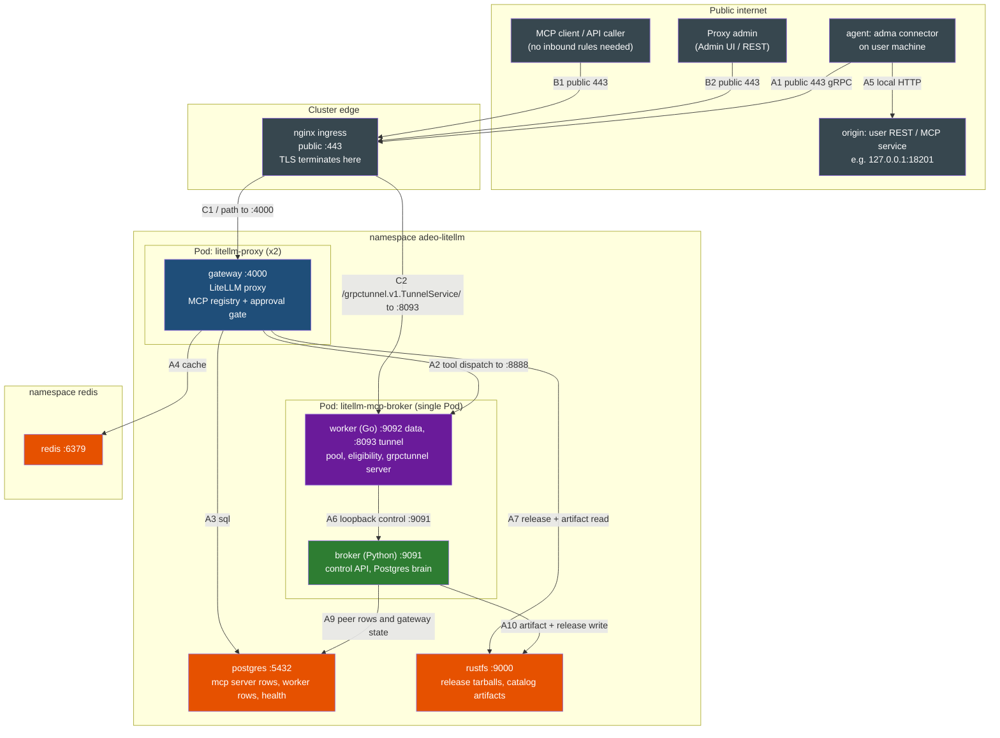

# Topology: every entity, port, and arrow

This file answers one question: what connects to what, on which port, in which direction, and why. Read the whole file top to bottom the first time. Later, jump to the section for the arrow you are unsure about.

If a detail here disagrees with code or with `../mcp-source-broker/running-system/README.md`, those win and this file is stale. The two-replica count is the audited prod shape, not an invariant. Check the live Deployment before using it as temporary evidence

---

## 0. The entities, named

| Short name | Full name | Kind | Where | Port(s) it listens on |
|---|---|---|---|---|
| `nginx` | ingress-nginx controller | Deployment, `ingress-nginx` ns | cluster edge | public 443 |
| `gateway` | `litellm-proxy` Deployment, 2 replicas | Python (LiteLLM proxy) | `adeo-litellm` ns, node `adeo-gpu-03` | 4000 |
| `broker` | `litellm-mcp-broker` Pod, container `broker` | Python (FastAPI) | `adeo-litellm` ns, node `adeo-gpu-03` | 9091 |
| `worker` | same Pod, container `source-link` | Go (`/source-link worker`) | `adeo-litellm` ns, same Pod as `broker` | 9092, 8093 |
| `postgres` | CNPG cluster `adeo-litellm-postgres` | Database | `adeo-litellm` ns | 5432 |
| `rustfs` | `rustfs` Deployment | S3-compatible object store | `adeo-litellm` ns | 9000 |
| `redis` | `litellm-redis` | Cache | `redis` ns | 6379 |
| `agent` | `adma` binary on a user machine | Go (`adma connector`) | user workstation | none, it dials out |
| `origin` | the user's own REST or MCP service | whatever the user runs | user workstation / local net | user-chosen, e.g. 18201 |
| `client` | an MCP client or API caller | external | anywhere | none |
| `admin` | a proxy admin, using the Admin UI or REST | human | anywhere | none |

Three things to burn in:

- `broker` and `worker` are **the same Kubernetes Pod**. They share a network namespace, so `worker` is reachable at `127.0.0.1` from `broker`. That is not an accident, it is load-bearing (see arrow A6).
- `agent` and `origin` are **on the user's side**, behind a firewall that allows outbound only.
- There are **two different public Ingress objects** on the same hostname, split by path. That is the single most confusing part of this design and section 2 explains it.

---

## 1. The picture



Arrow labels `A*` are the runtime and internal calls. `B*` and `C*` are the public entry path. Each is explained below in the same order.

---

## 2. Public routing: one hostname, two Ingresses

This is the part that does not fit in a head without drawing it.

There are two Ingress objects in `adeo-litellm`, both claiming host `litellm.ecouncil.ae`, both behind the same TLS secret `litellm-ecouncil-ae-tls`.

| Ingress object | File | Paths | Backend | Backend protocol |
|---|---|---|---|---|
| `litellm-proxy` | `deploy/prod/litellm-ingress.yaml` | `/` (Prefix) | `svc/litellm-proxy:4000` | HTTP (default) |
| `litellm-mcp-tunnel` | `deploy/prod/mcp-tunnel-ingress.yaml` | `/grpctunnel.v1.TunnelService/` (Prefix) | `svc/litellm-mcp-broker:link-tunnel` (8093) | `GRPC` |

Why two objects and not two paths in one: `nginx.ingress.kubernetes.io/backend-protocol: "GRPC"` is a **per-Ingress annotation**, not per-path. If you set it on the gateway's Ingress to make the tunnel work, every other gateway request would also be spoken to as gRPC and break. So the tunnel path has to live in its own Ingress with its own annotations.

nginx picks the **longest matching prefix**, so:

```
request to https://litellm.ecouncil.ae/grpctunnel.v1.TunnelService/OpenReverseTunnel
  -> matches /grpctunnel.v1.TunnelService/ (longer) -> broker worker :8093 over GRPC
request to https://litellm.ecouncil.ae/v1/chat/completions
  -> matches / only -> gateway :4000 over HTTP
```

Annotations on the tunnel Ingress and why each exists:

| Annotation | Value | Why |
|---|---|---|
| `backend-protocol` | `GRPC` | nginx must speak HTTP/2 cleartext (h2c) to the worker so gRPC framing survives |
| `proxy-read-timeout` | `3600` | default 60s would cut an idle tunnel; the agent would see a silent reconnect loop |
| `proxy-send-timeout` | `3600` | same reason, other direction |
| `proxy-buffering` | `off` | the tunnel is a live bidirectional stream, buffering would delay or stall it |
| `proxy-request-buffering` | `off` | same |

The normal gateway Ingress sets `proxy-body-size: "0"`, but that annotation does not affect the separate tunnel Ingress. **Open deployment hardening, observed on prod 2026-11-24:** `deploy/prod/mcp-tunnel-ingress.yaml` and the live `litellm-mcp-tunnel` object do not set `proxy-body-size: "0"`. The dev tunnel fixture and `tests/deploy/test_source_link_ingress.py` require it because the reverse tunnel is one long-lived client-streaming POST whose cumulative body can exceed nginx's default 1 MiB cap. Add the annotation to the prod tunnel object and regression test, then rehearse a cumulative large-throughput stream before treating the hardening as closed. Keep automatic source enrollment and ordinary per-request bodies bounded separately

Anything that falls through to `/` and is not a gateway route returns the gateway's own 404 JSON. That is the tell-tale when the tunnel Ingress is missing: a probe of the tunnel path answers `404 application/json` instead of gRPC content.

---

## 3. Every arrow, one at a time

### A1. agent -> nginx, public 443, gRPC

- **Initiator**: the connector binary on the user machine, `internal/connector/tunnel.go` `DialTarget(accountURL)`.
- **Direction**: outbound from the user. The user never opens a port.
- **Carries**: one `TunnelService/OpenReverseTunnel` gRPC stream, plus metadata `x-source-member`, `x-source-generation`, `authorization: <credential>`.
- **Why it goes here**: the gateway cannot make connections into a customer network, so the only way back is for the customer to dial out and keep the line open. This is the entire premise of the feature.
- **Default port**: 443, applied by `DialTarget` when the account URL has no port. This one function exists because passing the raw URL with its `https://` scheme to the gRPC dialer silently killed every attempt on a 15s timeout.

### B1. client -> nginx, public 443, HTTP

- **Initiator**: an MCP client or API caller.
- **Carries**: normal LiteLLM API calls, including `POST /mcp-rest/tools/call` and `/v1/mcp/...`.
- **Why**: the client only ever talks to the gateway. It has no idea a tunnel exists.

### B2. admin -> nginx, public 443, HTTP

- **Initiator**: a proxy admin in the Admin UI or via REST.
- **Carries**: approval (`PUT /v1/mcp/server/{id}/approve`), rejection, guardrail edits, and the release publish route.
- **Why**: approval is an admin action by design. Enrollment is self-service, approval is not.

### C1. nginx -> gateway :4000, HTTP

- **Direction**: nginx opens it, one per request.
- **Carries**: every path except `/grpctunnel.v1.TunnelService/`.
- **Why**: the gateway is the HTTP front door, the approval gate, and the tool registry.

### C2. nginx -> worker :8093, gRPC over h2c

- **Direction**: nginx opens it, one per connector tunnel.
- **Carries**: only `/grpctunnel.v1.TunnelService/*`.
- **Why a separate listener**: the worker has a strict rule, `HTTPHandler` in `internal/tunnel/tunnel.go` answers 404 "this listener serves gRPC only" to anything that is not HTTP/2 with `content-type: application/grpc`. Keeping it separate means the tunnel port can never be used as a general HTTP proxy.

### A2. gateway -> worker, Service port 8888 to container 9092, HTTP and h2c

- **Initiator**: the gateway, when a tool call for a source arrives.
- **Direction**: gateway dials the broker Service. This is the only gateway-to-broker path for data.
- **Address**: always `http://litellm-mcp-broker.adeo-litellm.svc.cluster.local:8888/sources/<source_id>`. The gateway stores this URL on each MCP server row at enrollment time, from `MCP_SOURCE_BROKER_DATA_PLANE_URL`.
- **Credential**: the gateway sends `Authorization: Bearer <service-token>`, because the enrollment wrote `credentials={"auth_value": <service-token>}` into the MCP server row. The worker compares it in constant time against the token digest.
- **Carries**: the origin-bound HTTP request after the pool has stripped gateway credentials, cookies, and hop-by-hop headers down to a strict allowlist.
- **Why port 8888 and not 9092**: 8888 is the **Service** port, a standard data-plane number; 9092 is the container port. The gateway never knows container ports. The `NetworkPolicy` matches pod ports after Service DNAT, which is why it lists 9092 even though callers use 8888.
- **Same listener also does two more jobs**: `GET /readyz` for the kubelet readiness probe, and `POST /v1/source-link/revoke` for loopback-only revocation. All three live on 9092 behind `link-data`.

### A3. gateway -> postgres :5432, SQL

- **Carries**: all normal LiteLLM state, including the `LiteLLM_MCPServerTable` rows that describe each source (`server_id`, `url` at 8888, `spec_path`, access group, `approval_status`).
- **Why it matters here**: this table is the registry and the approval gate. A source row exists but serves nothing until `approval_status` flips to active.

### A4. gateway -> redis :6379, cache

- **Carries**: standard LiteLLM caching and routing state, not tunnel state.
- **Why listed**: so you do not confuse it with the broker. The broker does not use Redis. Only the gateway does.

### A5. agent -> origin, plain local HTTP

- **Initiator**: the agent, inside `Server.Execute` / `ExecuteStream` in `internal/connector/tunnel.go`, and inside `setup.HTTPOpenAPIFetcher` at `source add` time.
- **Direction**: agent dials the origin on the user's own network.
- **Not through the tunnel**: the tunnel is for the gateway, not for reaching the origin. The origin is local to the agent and the agent is the only party that can reach it.
- **Host header**: set to the target's own `host:port`, so an origin behind a service router or a DNS-rebinding-protected MCP server sees the name it expects.

### A6. worker -> broker, loopback 127.0.0.1:9091, HTTP

- **Initiator**: the worker, on startup and every 2 seconds (`reconcileLoop` refreshes peers; `probeLoop` reports health).
- **Direction**: worker dials the Python control app on loopback because they share the Pod network namespace.
- **Carries**: `GET /v1/source-link/peers` to load the peer list, `POST /v1/source-link/report` to post a probe result.
- **Credential**: `Bearer <service-token>`.
- **Why same Pod**: this loopback hop only works if both containers share a namespace, which is why they are one Pod and not two Deployments. The reverse direction, the Python broker calling Go to revoke a session locally, also assumes loopback and the Go revoke endpoint accepts **loopback callers only**.

### A7. gateway -> rustfs :9000, S3 API

- **Initiator**: the gateway, two ways.
  - Serving the installer: `GET /install/source-agent` reads the active release manifest and assets from RustFS, then streams them.
  - Serving a catalog: an OpenAPI source's `spec_path` points at a gateway URL that resolves to the artifact mirror, which the gateway fetches so it can build tools from the document.
- **Why**: release artifacts and catalogs must survive gateway restarts and be shared across replicas, so they live in object storage, not on a Pod's disk.

### A8. worker -> broker for peer state, not SQL

The worker does not talk to Postgres directly. Its Go `internal/control` client only speaks HTTP: worker -> broker on `127.0.0.1:9091` -> Postgres. There is deliberately no separate database arrow in the topology. The diagram's A6 covers this control-plane connection, and A9 is its database counterpart.

### A9. broker -> postgres :5432, SQL

- **Carries**: source rows (`OicmMcpSource`), worker rows (`OicmMcpRemoteWorker`), the enrollment anchor row (`OicmMcpEnrollment`), and health, lifecycle, and generation state. This is the authoritative peer state the worker caches.
- **Why the broker must share the gateway's database**: a broker pointed at a different database sees no gateway-enrolled rows, and every connector gets `connector unauthorized` with an empty peer list. That is a documented failure mode, and it is why the prod broker takes `DATABASE_URL` from `litellm-db-credentials`, the same secret the gateway uses.

### A10. broker -> rustfs :9000

- **Carries**: writing the catalog artifact for an enrolled OpenAPI source, and the release publish route (`PUT /install/admin/v1/source-agent/release`) uploading a new agent binary.

---

## 4. Inside the broker Pod: who is the brain, who is the muscle

```
+--------------------------------------------------------------+
| Pod: litellm-mcp-broker                                       |
|                                                              |
|  +-----------------------------+   +----------------------+  |
|  | broker (Python)             |   | worker (Go)          |  |
|  | python -m ...broker.main    |   | /source-link worker  |  |
|  |                             |   |                      |  |
|  | :9091 remote-control        |<--+--A6 loopback---------+  |
|  |  - /v1/source-link/peers    |   | :9092 link-data      |  |
|  |  - /v1/source-link/report   |   |  - /readyz           |  |
|  |  - /v1/source-link/revoke   |   |  - /sources/{id}/... |  |
|  |  - /health                  |   |  - /v1/source-link/  |  |
|  |                             |   |       revoke (lpbk)  |  |
|  | talks to Postgres, RustFS   |   | :8093 link-tunnel    |  |
|  +-----------------------------+   |  - grpctunnel only   |  |
|                                    +----------------------+  |
|                                                              |
+--------------------------------------------------------------+
```

| Container | Port | Listener name | Protocol | Who calls it | Owns |
|---|---|---|---|---|---|
| `broker` | 9091 | `remote-control` | HTTP | worker (loopback), admin via port-forward | peer list, health reports, lifecycle, revoke fan-out |
| `worker` | 9092 | `link-data` | HTTP/1.1 **and** h2c | gateway (via Service 8888), kubelet, broker loopback | request forwarding, revocation, readiness |
| `worker` | 8093 | `link-tunnel` | h2c only | connectors (via ingress or port-forward) | the grpctunnel server |

Service `litellm-mcp-broker` maps:

| Service port | Name | Target | Why that number |
|---|---|---|---|
| 8888 | `data` | `link-data` (9092) | standard gateway-facing data-plane number, so no magic container port leaks into gateway config |
| 8093 | `link-tunnel` | `link-tunnel` (8093) | tunnel ingress backend |
| 9091 | `remote-control` | 9091 | admin port-forward target |

Note a wrinkle worth knowing: `overlays/prod/mcp-source-broker/broker.yaml` also declares a Service `litellm-mcp-broker` with only port 9091, and `source-link-patch.yaml` patches in a Service with the same name carrying 8888, 8093, and 9091. Kustomize merges them, so the final Service has all three ports. If you read only `broker.yaml` you would wrongly conclude the Service has no data port.

---

## 5. Inside the worker: the objects that make routing decisions

This is the Go side. One process, and inside it:

| Object | File | Job |
|---|---|---|
| `control.Client` | `internal/control/control.go` | caches peer state, posts health reports, compares secrets |
| `pool.Runtime` | `internal/pool/registry.go` | the session registry: which connectors are connected |
| `pool.eligible` / `admitted` | `internal/pool/eligibility.go` | the **single** predicate deciding if a member may serve |
| `pool.pick` | `internal/pool/forward.go` | least in-flight, round-robin on tie |
| `pool.Forward` | `internal/pool/forward.go` | the reverse proxy entry point, header stripping, redirect dropping |
| `tunnel.Runtime` | `internal/tunnel/tunnel.go` | grpctunnel server, admission, per-member probe loop |
| `tunnel.Member` | `internal/tunnel/tunnel.go` | one live tunnel, also used as an `http.RoundTripper` |
| `connector.Server` | `internal/connector/tunnel.go` | connector side, answers Admit, Probe, Execute, ExecuteStream |

The control loop timing:

| Loop | Interval | File |
|---|---|---|
| peer refresh + reconcile (close dead or fenced sessions) | 2s | `main.go` `reconcileLoop` |
| per-member probe (push Probe, report health) | 2s cadence | `internal/tunnel/tunnel.go` `probeLoop` |
| health trust after a transient probe failure | 30s grace | `HealthGracePeriod` |
| probe RPC deadline | 2s | `ProbeTimeout` |
| admit handshake deadline | 10s | `AdmitTimeout` |
| Execute time-to-headers deadline | shared `wire.ResponseDeadline` (90s) | `wire` |
| mcp-sidecar-pin / reconcile of manifests | on deploy | Makefile |

The eligibility predicate, restated as a checklist, because it is the heart of the whole thing. A member may serve `source_id` only if all are true:

1. the worker row still exists,
2. `phase == "active"`,
3. not fenced (same generation, not revoked),
4. catalog proven (OpenAPI: fingerprint equals expected; MCP: no fingerprint needed, a recent probe is the proof),
5. a successful probe within the grace window,
6. advertises the `execute` capability.

If a stateful request (has `Mcp-Session-Id`, `Last-Event-Id`, or SSE `Accept`) sees more than one eligible member, it is refused with 409 rather than mis-routed.

---

## 6. What each credential is, and where it can travel

| Secret | Made from | Lives in | Who holds it | Who must never see it |
|---|---|---|---|---|
| user virtual key | gateway `/sso/cli/password` exchange | agent `~/.config/source-agent/accounts/<alias>.key` mode 0600 | the user's own account | the broker, the origin |
| `service-token` | cluster secret `litellm-mcp-source-broker` | gateway env, broker env, worker env, and inside the MCP server row `credentials` | gateway, broker, worker | the user, the origin |
| `pepper` | same secret | gateway env, broker env | gateway, broker | the user, the agent, the origin |
| worker `credential` | derived from the pepper and the identity at issuance | stored in the connector identity file mode 0600; only its **digest** is stored in Postgres | the agent | everyone else |
| `X-Source-Signature` | Ed25519 from an origin that opts in | verified by the worker at probe time | the origin | not required any more |

The rule that falls out: the user's key never crosses into the broker, and the pepper never reaches the agent or the origin. The worker authenticates a tunnel by constant-time hashing the presented credential and comparing to the stored digest, which is why a revoked or old-pepper credential stops working after a restart.

---

## 7. Failure, translated into which arrow broke

| Symptom | Broken arrow or rule | Fix |
|---|---|---|
| tool call returns `503 no eligible connector` | A2 reached the worker but no member passed the eligibility checklist | start the agent, or wait one probe cycle |
| tool call returns `502 source upstream unavailable` | A2 to A5 succeeded at the hop but the origin refused | start the origin |
| agent logs `connection not ready` on dev | A1 pointed at the non-h2 TLS terminator | point at the h2c terminator on 18094 |
| every tunnel closes at once on prod, no server log | C2 fell through to `/` | apply `deploy/prod/mcp-tunnel-ingress.yaml` |
| `connector unauthorized` with empty peer list | A9 pointed at a different database | give the broker the gateway's `DATABASE_URL` |
| `connector unauthorized` with a non-empty peer list | pepper differs between gateway and broker | restart both against the same secret, then re-enroll |
| `stateful mcp routing requires a single connected member` | two connectors for one source | keep one connector per source |
| origin reports `credentials_seen=true` | header allowlist bypassed | this would be a bug in `forwardHeaders`; check it |

---

## 8. Environments differ in exactly three places

| | Prod | Dev |
|---|---|---|
| public routing | two Ingresses on `litellm.ecouncil.ae`, tunnel on 443 | **no ingress at all**; port-forwards only |
| reaching the tunnel | account URL, 443, nothing to set | `MCP_SOURCE_LINK_TUNNEL_URL=https://localhost:18094` plus `grpc_tls_proxy.py` and an 18093 forward |
| certificate | valid | self-signed, needs `MCP_SOURCE_LINK_INSECURE=1` |

Everything else, container ports, the Pod layout, the network policy shape, and the Go and Python code, is identical. Dev proves behavior through a forward, prod proves reachability through the tunnel Ingress. A dev proof that claims it ran through `litellm.ecouncil.ae` actually reached prod, because that hostname never fronts the dev broker.
