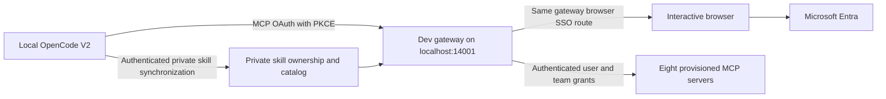

# OpenCode Microsoft SSO, MCP, and Private Skills Pilot Plan

This is the implementation plan for a separate worker. It covers an actual local OpenCode installation that signs a person in through the deployment's Microsoft SSO and then consumes the gateway's MCP servers and private skills with that person's team permissions

**Dev is mandatory before prod. Stop after a failed gate; do not work around it with an admin key, wider MCP grants, `allow_all_keys`, or anonymous skill publication.** The plan is based on source and live read-only probes from 2026-11-24. It is not an authorization to change Entra or prod before presenting the dev evidence

## 1. Dev pilot

### 1.1 Objective and final acceptance contract

Use OpenCode V2, the gateway's aggregate MCP endpoint, and the deployment's Microsoft browser SSO. Do not fork OpenCode or implement a custom MCP protocol



OpenCode performs ordinary MCP Streamable HTTP and JSON-RPC. The gateway performs Microsoft SSO and owns its browser-OAuth client integration. OpenCode stores its OAuth session credential outside the repository. It does not contain an Entra access token or a manually distributed gateway `sk-...` credential; the gateway's MCP-session credential identifies the signed-in user

A completed dev pilot means all of the following:

| Surface | Consumer-visible proof |
|---|---|
| Microsoft SSO | An interactive Microsoft login as `jyao@ecouncil.ae`, with no admin key pasted into OpenCode |
| MCP connection | `opencode mcp list` reports the configured gateway connected, not merely registered |
| MCP discovery | A reconnect/refresh discovers every server currently granted to the pilot team, not all registry servers indiscriminately |
| MCP execution | OpenCode successfully invokes one documented read-only tool from each granted MCP server |
| Models | At least one permitted ordinary model round trip succeeds with a server-side model selected by the application configuration, without disclosing upstream provider credentials to the client |
| Skills API | A permitted identity lists and retrieves its authorized skill through the actual API, while a second identity is denied the private skill |
| OpenCode skills | OpenCode discovers and loads a benign private test skill from its private synchronization path; changing that skill's description changes what OpenCode displays as available |
| Revocation | Logging out or removing the test user's grant causes the intended access loss and does not delete source servers or other users' grants |

### 1.2 Agent deliverables

Produce these artifacts with no secrets in their contents:

| Artifact | Contents |
|---|---|
| Updated OICM proxy/Entra manifests | The smallest changes proven on dev; dev and prod remain explicit overlays |
| A small pilot configuration | OpenCode V2 configuration with `mcp.servers`, no literal credentials, and the correct aggregate `/mcp` URL |
| Local pilot helper | Idempotent port-forward/liveness check if an existing helper cannot be reused; never download-and-pipe arbitrary installer scripts |
| Private skills integration | Only the smallest authenticated synchronization or supported client-extension change that is actually required, with meaningful denial and fixture-mutation tests |
| Dev evidence Note | Commands, actual versions, screenshots of SSO and connected/loaded functionality, redacted response headers, resource/grant counts, and blockers |
| Test and cleanup record | Test-team/skill/key/virtual-client cleanup, anything intentionally retained, and the final prod eligibility verdict |

Follow the repository's branch lifecycle: branch from its actual default using `python3 scripts/default_branch.py --branch`, understand and preserve unrelated working-tree edits, make only this pilot's changes, run relevant tests, then commit and push

### 1.3 Baseline and assumptions to establish, not silently assume

Run on the developer workstation's Linux/WSL environment, where OpenCode is already installed at `/home/linuxbrew/.linuxbrew/bin/opencode`. At planning time it reports `v2.0.27`; record the actually used version and confirm its current official configuration/environment substitutions

Before making mutations:

1. Record the current source branch, working-tree status, current image digests/rollouts, dev/prod SSO configuration, and any unrelated failed liveness checks. Do not conflate unrelated failures with this feature's regression
2. Use only the ADEO org already present: `19c3609c-b4ba-447e-8829-0765785038fa`
3. Check the live pilot-user identity and its real team/membership records. Do not select user rows solely by email text assumptions after switching identity mappings
4. Reuse or deliberately create `ADEOGPT-ENDUSERS` on dev as the pilot team; the known prod ID is `b19ad7de-997e-45ec-ba34-f7980dccf621`, not an automatic guarantee for dev
5. Read `GET /v1/mcp/server` as a proxy admin outside OpenCode and count the desired grants. The current prod state expected at planning time is eight servers, granted through `adeogpt-endusers-mcp`; assert that the consumer gets those intended server IDs, not a hard-coded future count
6. Keep a temporary second user or separately scoped test identity for negative permissions. It must not inherit the pilot team or private skill
7. Use one short-lived admin-side schema/key-lookup credential for setup, read its Secret/reference securely without printing it, and never place it in OpenCode, code, repos, screenshots, or terminal histories to be committed
8. Treat all SSO client secrets shown in prior terminals as exposed. Rotate the relevant Entra client Secret in Entra, update the appropriate dev/prod Kubernetes Secret and the permitted private local secret store together, and verify the old SSO Secret cannot log in. Do not rotate prod Secret values during the dev phase

The single dev entry address is `http://localhost:14001`. The public `https://litellm.ecouncil.ae` host serves prod and **must not** be used for any dev test. Use:

```bash
kubectl -n adeo-litellm port-forward svc/litellm-proxy-dev 14001:4000
```

Run it persistently, and re-run it after every dev rollout. Require `/health` directly on localhost before proceeding with a configuration or integration test. Keep separate browser windows/profile sessions for dev and prod so the wrong gateway session cookie cannot make evidence misleading

### 1.4 Phase D0: verify OpenCode and the dev OAuth discovery contract before editing gateway settings

Check the official client behavior for this exact installed version rather than copying the old version's flags or plugin API. In particular, OpenCode V2 uses `mcp.servers.<name>`, not direct top-level MCP server names

Verify read-only:

```bash
opencode --version
opencode mcp --help
curl -i 'http://localhost:14001/.well-known/oauth-protected-resource/mcp'
curl -i 'http://localhost:14001/.well-known/oauth-authorization-server/mcp'
```

The second document should advertise `authorization_endpoint` at `/authorize/mcp-session`, `registration_endpoint` at `/register`, `token_endpoint` at `/token`, and PKCE S256. That discovery advertises a capability, not a completed SSO handshake

Check from the source `gateway_dcr_flow.py`, `discoverable_endpoints.py`, `byok_oauth_endpoints.py`, and `ui_sso.py` that:

- The callback uses the gateway's `PROXY_BASE_URL`, not accidentally the SSO callback on prod
- The requested `client_id` construction is dynamic-client-registration compatible; reject unsafe redirect URIs
- OpenCode's Client ID Metadata Document (CIMD) preference versus gateway dynamic client registration (DCR) is understood, not patched blindly
- Loopback redirects work on this workstation. If the browser is on Windows but OpenCode runs in WSL/container/remote SSH, use the official remote-browser callback flow documented by the client's SSO/OAuth implementation, not a public reverse proxy for OpenCode
- Existing dev UI SSO login completes at `http://localhost:14001/sso/callback` and lands on a success state before adding OAuth automation

If CIMD discovery fails, confirm that the advertised authorization server metadata and OpenCode DCR fallback are used. Record the evidence; do not require a new custom OAuth implementation merely because the first discovery path is not supported

**Gate D0:** standard OpenCode CLI can manage native remote servers and dev's browser SSO is good on its local address. If not, fix the prerequisites and stop

### 1.5 Phase D1: isolate team, access groups, skill authorizations, and keyless identity

The aggregate MCP auth path should derive the pilot user's team/skill access from server-side membership and grants. Do not pre-seed a user's manually distributed virtual key in OpenCode

Inspect and, only if genuinely missing, assign to `ADEOGPT-ENDUSERS`:

| Need | Best practice |
|---|---|
| Models | An explicit permitted list, not an unnecessary all-model master key. Reuse the unified group's `access_model_names` or configured team model scope according to current source behavior |
| MCP | One unified `adeogpt-endusers-mcp` group with every desired test `access_mcp_server_ids`, not `allow_all_keys` on every server. Tool allowlists may narrow per server |
| Skills | Establish provenance through `created_by` (`user:<id>` or `team:<id>`, not ambiguous raw IDs) and assign a named shared grant with the unified `access_skill_names` |

Ownership and named skill grants are different authorization inputs. Do not assume that setting `access_skill_names` alone makes `/v1/skills` rows shareable, or that a user's `created_by` owner scope alone follows a team's access-group authorization. Inspect the request path, resolve the needed permission, and add the smallest missing server-side behavior with owner/team/denial tests before using OpenCode

For same-group/team assignments, use the source-confirmed MCP-capable endpoint `POST /v1/access_group`, not the older model-only documentation's `/access_group/new`. Before creating or updating anything, read all current group contents and merge required existing IDs; updates are replacement-like unless the schema/handler specifically defines patch semantics

Test two user identities before setting team-selection defaults:

1. `jyao@ecouncil.ae` is a team member with the intended capabilities
2. The negative identity is blocked from those team/skill resources
3. Auth uses the immutable Entra `oid` as gateway identity, `upn` as user email attribute; dir-source group mapping is not required for this pilot
4. Promote an ordinary user through team membership only. No `proxy_admin` identity is needed

**Identity divergence check:** if direct JWT or session admission resolves a duplicate user whose page/permissions differ from the UI-login record (for example `oid` versus legacy UUID), resolve/reconcile the canonical record first. Do not disable `user_id_upsert` to hide the issue or hand both records admin permissions. The source's canonical matched-DB-ID path must be demonstrated or flagged as a separate migration blocker

**Gate D1:** permitted user has only intended team-owned MCP/model/skill grants, negative identity cannot obtain them. Key credentials are not required in the OpenCode configuration

### 1.6 Phase D2: complete native MCP OAuth login against dev

Start with an isolated pilot project or OpenCode configuration directory under the repo's gitignored scratch area. Never modify the developer's normal config without backing it up. Use a literal equivalent of the following structure, adjusted only after reading the installed CLI's authoritative docs:

```jsonc
{
  "$schema": "https://opencode.ai/config.json",
  "mcp": {
    "servers": {
      "adeogpt-dev": {
        "type": "remote",
        "url": "http://localhost:14001/mcp"
      }
    }
  }
}
```

Where supported by that OpenCode build, prefer `opencode mcp add ... --url ...` to hand-editing config. Leave native OAuth enabled. No `headers`, `oauth: false`, Entra bearer, `x-litellm-api-key`, or master key belongs in this test

Run:

```bash
opencode mcp list
opencode mcp auth adeogpt-dev
opencode mcp list
```

Complete the browser step as `jyao@ecouncil.ae`. This may mean selecting the dev server in `/mcps` in a headful OpenCode if that is how this CLI build presents the interactive flow. If `mcp auth` exits without a browser, inspect its redacted debug output and the gateway discovery metadata first

Record:

- Exact login and callback endpoints used, without code/state/token values
- Issued credential type and storage location, displayed without revealing its contents. Validate that it is the MCP session rather than the original Microsoft token or a user-generated virtual key
- How selected team/membership is resolved during session mint, refresh, and request admission. Evidence must show timestamps and intended effective user/team IDs
- Access to all intended grants; user/team mismatch, missing membership, negative identity rejection
- How refresh works after expiration and whether `opencode mcp logout adeogpt-dev` destroys its locally stored session
- Multi-pod DCR/session behavior, ensuring a second pod can recognize what the first minted through shared storage/cache. Curl against localhost without port-forward never qualifies as a prod test; dev uses the local forward only

Configure model access for OpenCode according to its official `<version>` provider contract. This may use a supported provider base URL and a short-lived proxy API credential sourced from a local non-repository secret, but **it must not share or substitute a gateway master key**. If adding model access requires custom bearer handling, capture rather than normalize the failure. Distinguish successful MCP OAuth from an unsolved provider-auth setup; a failure in one is not evidence that the other worked

**Gate D2:** exact unmodified installed OpenCode connects over native MCP OAuth using the test person, with refresh/logout tested and no static credential in its configuration. The same client's generated MCP calls must reach dev through its local forward only

### 1.7 Phase D3: prove all intended MCP servers and functional limits

Through OpenCode, list and invoke each granted server, not merely the REST facade. The standard tests are:

```text
Client: POST /mcp                         (Streamable HTTP)
Messages: initialize, tools/list, tools/call
Read-only admin endpoints for comparison: /v1/mcp/server
Do not use: /mcp-rest/tools/call as the sole proof
Expected preference: aggregate /mcp; scoped endpoint /mcp/<server-name>
Legacy aliases: /<server-name>/mcp; /mcp/sse are not the new contract test
```

Assemble a per-server read-only test matrix while inspecting the live tool catalogs. Use one true non-side-effecting lookup/search/read call per granted server, including stable IDs and the minimal legal arguments from its `inputSchema`. Avoid writes such as posting/updating, deleting, deployment changes, long-running crawls, extra LLM generation, or expensive bulk downloads

A passed tool `name` may be server-prefixed as served through the aggregate; let the client's returned name control the subsequent call, not hand-built aliases. Treat successful `tools/call` as namespace/permission and execution proof, with a returned meaningful result/error appropriate to backend data availability. An upstream unreachable response or a malformed upstream response is a separate backend failure and must be documented rather than hidden as permission success

Verify simultaneously:

- The granted inventory compares to an admin baseline after the grants were changed purposefully
- A non-member gets empty server/no-unauthorized-tool results, or an authorization rejection if that is the protocol's response
- A permitted server can still reject a disallowed tool if tool-level permissions are configured
- Model access is not conflated with MCP permission coverage
- Each result names a real accessible server/tool/resource; screenshots inside OpenCode include enough full UI to reproduce it

**Gate D3:** every intended MCP server has one successful actual OpenCode invocation, the negative identity cannot cross the team boundary, and no direct REST test masquerades as OpenCode compatibility

### 1.8 Phase D4: implement and verify private skills, including the OpenCode compatibility gap

At planning time this checkout offers:

| Function | Source contract | Pilot decision |
|---|---|---|
| Authenticated Anthropic-style create/list/get/delete | `/v1/skills`, `/v1/skills/{skill_id}`, with bearer auth; semantic search requires an embedding model | Prove a private owner/team API workflow with `custom_llm_provider=litellm_proxy` and required beta flag |
| Authenticated private archive ZIP | Not an established OpenCode-facing route at planning time | Needed for private OpenCode synchronization; do not call the public archive instead |
| Public Agent Skills catalog | `/.well-known/agent-skills/index.json`, optional archive URL, built by `agent_skills_endpoints.py` | Disabled by default and excludes auth; enabling publishes every stored skill |
| OpenCode HTTP catalog | An OpenCode-defined unauthenticated `index.json` under the configured skills base URL with safe relative `files` lists | **Not the same as the gateway catalog, either shape or auth** |
| Standard `skills/list`/`skills/get` over MCP | Not implemented in this gateway | Do not invent a protocol extension or claim it as native support |
| Virtual skill tool | `skill_search` behind controlled permissions and embedding configuration | Optional independent feature, not a substitute for loading a skill into OpenCode |

The integration requirement is **the smallest authenticated owner/team-aware bridge from the available skill API/storage to OpenCode's configured skills sources**. Do not infer skills are done from GET `/v1/skills` alone; OpenCode must load the content through its native loading mechanism

Choose the smallest supported mechanism in this order:

1. If OpenCode V2 supports authenticated HTTP catalog headers or an official plugin/client extension for that authentication, use it without changing OpenCode's MCP protocol or making its storage global public
2. If no such authenticated catalog exists, implement a focused local private sync using the existing authenticated `/v1/skills` APIs plus an authenticated owner-scoped skill archive route on the gateway. Align it with the existing `agent_skills_archive.py` archive builder and validate participants and paths before downloading/unzipping. Do not expose `GET /v1/skills/{id}/archive` anonymously under the existing `public_skills_index` endpoint
3. If the API's actual archive and metadata semantics cannot meet that contract safely, stop in dev. Write the source-backed blocker and decision. Do not fake a generic catalog of all database skill rows

The selected route must validate both session authentication and actual team/permission route access, and must call the `created_by` resource ownership logic already used for skills. Never accept a bearer/skill owner from a query parameter or an OpenCode request body. Require an owning request/user context and use resource-constrained ZIP traversal that refuses unknown members, path escaping, symlinks, decompression bombs, absolute paths, or invalid SKILL.md names. No arbitrary script execution belongs in the syncer's validation

For a successful archive bridge:

- Preserve OpenCode's expected `skills` source/index schema: a valid entry contains a `name`, monotonically increasing `version`, and safe relative `files` list containing its `SKILL.md`
- Use the approved OpenCode plugin or CLI catalog setup if supported; otherwise file a local owned skill-directory copy under a gitignored pilot root, not an unannounced overwrite of the user's existing `~/.config/opencode/skills`
- Preserve team/skill ownership checks for index, every artifact, and subsequent update/delete behavior. Test an enumerated private UUID cannot be downloaded by another user
- Protect freshness using the skill's `updated_at`, an explicit controlled revision marker, or content-derived authentication digest appropriately exposed by source; do not hardcode old versions or leave stale local skill content invisibly installed
- Use per-user config/source roots and atomic writes, not another pilot user's installation state
- Keep MCP and skill concern separate; this plan does not turn skills into MCP tools unless a future specific feature requires it

Prove both ends independently:

| Stage | Required proof |
|---|---|
| Fixtures | OpenCode-native folder/zip with `SKILL.md`, safe supporting markdown reference, no executable or secret. Delete cleanly afterward |
| Upload | Authorized API create via `POST /v1/skills?beta=true` with `custom_llm_provider=litellm_proxy` and form-file upload |
| List | The intended human/team gets that skill through `/v1/skills`; not the short-lived proxy-admin view |
| Ownership | A separate identity cannot list/get/download the private skill through index, archive, direct ID, or any added route |
| OpenCode discovery | Configure that catalog or local sync in the pilot project and see the correct available skill name/description in OpenCode |
| Functional load | Ask OpenCode/native skill tool to load it by ID and verify returned body has the distinctive harmless marker from `SKILL.md` |
| Mutation | Temporarily alter description/body/ownership in the fixture and show discovery or access updates/stops accordingly; restore harmless content or remove fixture afterward |
| Resource cleanup | No remaining fight with real private skills, no temporary public index, and original user's global skills preserved |

If end-to-end private skills stay unfinished after D4, prod cannot be presented as supporting "all MCP and skills functionality." Finish the gap, explicitly descope private skills with the user's approval, or stop with the evidence-backed block

**Gate D4:** API security plus real OpenCode loading pass, not merely one of those; negative download and content-freshness tests pass

### 1.9 Phase D5: packaging, repeatable evidence, and prod go/no-go decision

Build a single idempotent pilot process runnable from local command line once the dev proxy is healthy. Prefer a short documented command sequence plus a configuration example over a large opaque test harness

Include exact configurable gateway/SSO callback, team UUID, and skill catalog/sync location, without embedding tenant secrets, tokens, private skill contents, or raw login sessions in the repository. Run meaningful unit tests for ownership, groups changing, revocation, and ZIP validation. Exercise endpoint changes through the appropriate source-mirroring unit-test tree and any relevant smoke client conventions

Produce `docs/mcp-architecture-qa/16-opencode-dev-pilot-evidence.md` once dev is performed. Show OpenCode before/after screenshots of MCP authentication, tool calls for all intended MCP servers, and loaded private skill. Provide reproduction steps using placeholder variables for secrets. Record the group's `assigned_team_ids`, exact applied manifest diff, and signed test user's effective canonical identity without exposing credentials

Do not automatically generate a PR. Deliberate pilot review should check source/config diff, identity canonicalization, custom OAuth callback semantics, permissions, single team context, private public-index attack surface, and test cleanup. Any known skipped negative test is a failure gate, not a note to ignore

### 1.10 Dev acceptance gates checklist for prod request

- [ ] Local OpenCode CLI version/flag compatibility checked and no fork needed
- [ ] Microsoft browser SSO works on local dev base/callback, not prod
- [ ] Native MCP OAuth login, issued-session refresh, local logout/revocation proven
- [ ] Correct user/team; duplicate identity never granted; no admin key in OpenCode
- [ ] Every intended MCP server's discovery and real read-only tool call succeeds from OpenCode
- [ ] Negative user server/tool/model checks block the access not granted
- [ ] Authorized list/get/owner archive APIs work for private skill
- [ ] Real OpenCode loads the safe private skill through the completed authentication bridge
- [ ] Public MCP registry and public skill index remain off unless separately approved
- [ ] Repeated requests/restart and shared-state fail-over work; dev rollout has stable health
- [ ] Tests pass, no unrelated config changed, evidence and cleanup recorded, source committed and pushed

Any blank item blocks prod

## 2. Prod pilot

### 2.1 Prod prerequisites and rollout authority

**The executing worker must stop after the dev evidence and obtain jyao's explicit go-ahead before applying any prod configuration, group assignments, skill changes, Entra/App registration mutations, or rollouts.** If already authorized in its exact task issue/chat, keep that approval attached to the assigned work alongside the evidence. Otherwise stop rather than infer prod permission from a plan review

Prod differs from dev by hostname, Entra app registration, callback, image/digest policy, and blast radius. Do not reinterpret success on `localhost:14001` as success through the prod host

Before starting:

1. Show the dev artifact checklist and intentionally repeated dynamic-cli setup; bring prod changes only after every D gate passes
2. Check real default branch using `python3 scripts/default_branch.py --branch` before the eventual PR and update only the associated prod overlay/base delta needed for the same tested function
3. Pull and inspect production. Do not overwrite unrelated branch edits or replace the prod gateway `general_settings` block scalar improperly
4. Reconfirm org and team live by aliases and UUIDs, because prod is not necessarily an exact DB copy of dev
5. Compare dev/prod MCP server IDs, aliases, existing group members, tool permissions, approved model names, and private skill ownership. Do not change another team's group when granting the pilot team; create/patch a specifically assigned group
6. Rehearse the rollout check with correct manifest-digest build/deploy targets. Never pin a container config-blob digest as the image digest, and make no silent tag-only fallback
7. The public prod base is exactly `https://litellm.ecouncil.ae`. Its Microsoft callback is exactly `https://litellm.ecouncil.ae/sso/callback`. The prod gateway must use its **prod** Entra client ID/secret, not staging

If this pilot required a new Entra scope or application auth setting only for forwarded JWTs, distinguish it from the browser SSO app used by native MCP OAuth. Do not require a direct Microsoft-audience token for OpenCode when it actually uses a session minted by the gateway. The worker must explain this from observed session admission rather than inventing one token type for both

### 2.2 Phase P0: deploy and confirm existing prod OAuth discovery, SSO, and group grants

Roll out only the tested artifacts. Perform ordinary browser login directly on prod via the same existing Microsoft SSO configuration. Use readonly discovery checks:

```bash
curl -i 'https://litellm.ecouncil.ae/.well-known/oauth-protected-resource/mcp'
curl -i 'https://litellm.ecouncil.ae/.well-known/oauth-authorization-server/mcp'
curl -i 'https://litellm.ecouncil.ae/v1/mcp/registry.json'
curl -i 'https://litellm.ecouncil.ae/.well-known/agent-skills/index.json'
```

The first two should remain live (source and pre-pilot read probes confirm this basic discovery before the integration work). The last two must remain disabled/absent unless publication is explicitly approved separately; `404` does not indicate that private `/v1/skills` is unavailable

Do not enable `enable_mcp_registry` for this pilot. `/mcp` aggregate is the consumer registration point. Do not enable `litellm_settings.public_skills_index`; this would be a severe authorization regression for private content

Validate the chosen prod `ADEOGPT-ENDUSERS` team and attached `adeogpt-endusers-mcp` group or the corresponding final tested grant bundle before sign-in. At planning time prod has eight MCP servers, and the pilot team was previously granted that set. Do not hard-code eight as a permanent future invariant; compare live intended assets

**Gate P0:** prod exact version/config/public host consistency, granted inventory reconciliation, no accidental anonymous catalogs, health reads stable, ability to roll back config/images known

### 2.3 Phase P1: actual local OpenCode prod Microsoft SSO flow

Make a distinct local client server name and config name to ensure profiles cannot be confused:

```jsonc
{
  "$schema": "https://opencode.ai/config.json",
  "mcp": {
    "servers": {
      "adeogpt-prod": {
        "type": "remote",
        "url": "https://litellm.ecouncil.ae/mcp"
      }
    }
  }
}
```

Keep native OAuth enabled and no static API key header in that configuration. Clear only the pilot's old stale session with `opencode mcp logout adeogpt-prod` if appropriate; it is not an invite to delete source servers or user accounts

Run:

```bash
opencode mcp list
opencode mcp auth adeogpt-prod
opencode mcp list
```

Complete the Microsoft login using `jyao@ecouncil.ae` in the browser, deliberately not a proxy-admin account. If a previous dev UI SSO session exists, use a separate browser profile or explicitly inspect effective identity. Evidence must show actual user/team attribution on prod, not just that the OAuth redirect completed

Check at least two pod redirections or repeated requests after session mint/refresh so shared cache/session state is demonstrated. If the proxy is restarted during the pilot, redo the connection/refresh rather than assuming a cookie still works

Show that, separately, the dev local endpoint no longer receives prod evidence. Stop or isolate the dev port-forward before prod checks where hostname ambiguity could create a false-positive result

**Gate P1:** connected state on prod, correct signed-in human, no literal credential committed, repeated request/refresh recognizes user authorization after crossing app replicas

### 2.4 Phase P2: all MCP servers on prod and negative authorization tests

Run the dev test matrix through the actual prod OpenCode UI and its discovered tools. Never substitute the prior `/mcp-rest/tools/call` cURL exercise as native client proof

For every intended server, capture the granted tool inventory and one harmless actual invocation from OpenCode. A tool whose only available operation would mutate external state does **not** gain permission because it needs a test; either use a suitable read discovered from the schema, document why existing read-only data cannot be used and seek approval, or stop with a delimited limitation. Do not fabricate successful evidence for every server when the remaining server's backend is broken

Prove negative controls with a second, ungranted team/identity:

- Aggregate MCP discovery excludes unauthorized team resources, as the source calls for
- Picking an unauthorized MCP tool cannot succeed, even if the person knows its actual name
- Model scope stays bounded to expected allowed models
- An unsupported direct-JWT team selection is not justified by an API-key test. For browser OAuth tests, document the actual admitted-subject resolution path observed

Repeat the same invocation with the actual registered short-lived API key only as an independent control, not as the goal of this pilot. If multi-team key behavior was previously proven, recognize it does not automatically equate to session auth behavior for all team memberships

**Gate P2:** native OpenCode connects to every granted prod MCP server, a real result is obtained for each supported read-only tool, and negative access controls in the same auth channel succeed

### 2.5 Phase P3: prod private skills on OpenCode

Deploy only the private-auth skill path that passed dev. Keep `public_skills_index` off. The public discovery shape is unauthenticated by implementation and should not be changed just to make OpenCode compatible without the necessary owner-scoped design

Use a new disposable harmless prod fixture named so it can be deleted confidently. Have the permitted identity upload/list it on prod via the same authenticated Anthropic-compatible API as dev, with `beta=true` and `custom_llm_provider=litellm_proxy`. The test should prove its gateway row owner is the actual human/team, not an admin

Repeat both proof layers:

1. Proxy skill contract: list/get/archive, ownership nil for a second identity, server update/revision behavior, and deletion behavior
2. OpenCode: discover the skill using native skill sources/configured sync, trigger its explicit load by ID, and verify the marker/body and safe referenced files are the expected own-team package

Overwrite/cleanup code must not archive/delete existing non-test skills. Use explicit test IDs tied to the created response or back up solely the safe test assets being manipulated. Remove test skills and temporary private packages after evidence collection, keeping only configuration required for an intentional retained pilot

The `mcp_tool_search_enabled` virtual `skill_search` capability is an optional separate feature gated on permissions and `skill_search_embedding_model`. Do not enable or claim it as part of "all skills working" unless this separate behavior is approved, configured, unit tested, and live verified. It does not replace actual OpenCode `SKILL.md` loading

**Gate P3:** native OpenCode actual private skill load with owner isolation, freshness behavior, and no anonymous catalog/archive access

### 2.6 Phase P4: cleanup, operational handoff, and final status

Produce `docs/mcp-architecture-qa/17-opencode-prod-pilot-evidence.md`. Keep evidence short but complete: exact client/server versions, public routes (no query credentials), command excerpts, failure corrections, applied image/digest IDs, assigned groups and resource reconciliation, screenshots of OpenCode UI, and safe before/after skill-loading proof

Complete cleanup consciously:

- Delete exposed short-lived MCP virtual keys, including the already printed `jyao-adeogpt-mcp` key, from `/key/delete` with scoped admin credential. Deleting a local key file is not server-side revocation
- Remove temporary admin fixture keys and temporary test team/group assignments if not deliberately retained
- Remove disposable test skills only after retrieving their generated IDs and validating those IDs refer to the fixture; leave ordinary production skills alone
- Clear/dispose only the OpenCode session's stale test credentials or pilot project root, not all users' sessions or unrelated code
- Keep `ADEOGPT-ENDUSERS` grants only if this team is intended as the final consumer pilot security boundary
- Check logs/alerts for authorization failures, callback mistakes, TTL/material changes, upstream outage, spend, or unexpected unauthenticated downloads
- Rollback plan remains available and any new prod Secret rotation is scheduled and evidenced separately

Update the owning guide/index with the implemented endpoints, supported OpenCode auth model, default-off catalogs, membership/team semantics, and any unresolved skills limitation. Do not hide the gap if the product still requires an integration helper for OpenCode-authenticated catalogs

Before requesting a final review or PR, check default branch with `python3 scripts/default_branch.py --branch`, read the full `.github/pull_request_template.md`, and publish only tested commits. Do not mix cleanup or DB policy changes with the OpenCode pilot work

### 2.7 Exit criteria and response for the dev/prod split

For each surface keep an explicit status table: proof URL, tested identity summary, server/data-plane resource, required permissions, side-effect-free request name, actual response class, and retain/delete disposition

Stop if:

- OAuth "connected" was faked by API-key config after OAuth was not completed
- Only the REST facade was proven, not OpenCode
- All intended servers were not found/read through the user-selected MCP
- The only way to load private skills was to make the catalog or archive public
- A second identity could discover/download unauthorized resources
- prod public hostname was used as evidence for dev without a local forward
- New SDK/gen/backend dependency/command was never actually executed or its failure was rationalized away

Reply with read-only discovery results before any mutation, dev-plan execution results distinguishing proven/failed/skipped checks, prod gates confirmed before applying non-readonly changes, remaining blockers, and tested commit link/diff evidence. No silent "works" report unless both the **native OpenCode MCP** and the **private OpenCode skill loading** surfaces were seen working on both environments

