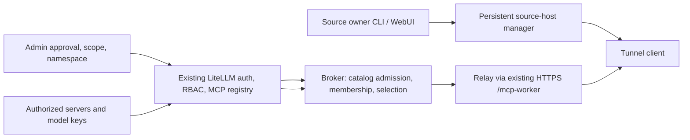

# MCP source lifecycle and pooling research questions

Status: open research questions, not an implementation or delivery commitment. Written 2026-11-13 after the dev single-source delivery. Answers should come from the dedicated research agent. Current dev tunnel, connector, gateway, and production stay untouched until decisions are approved

## What works today

The gateway renders a per-connector installer that carries source-scoped relay credentials and an assigned loopback listener lease. It downloads the pinned Chisel 1.12.0 archive from the gateway HTTPS mirror, verifies SHA-256, stores secrets in a mode-600 environment file, and enables a user-systemd unit with `Restart=always`. Chisel retries indefinitely, so the same reverse mapping returns after a process, network, or pod failure. After a host reboot the enabled unit returns under user systemd with linger

The broker marks a member healthy only after probing the actual OpenAPI catalog fingerprint through the tunnel. A connected tunnel alone never re-enables dispatch. Source, enrollment, and membership live in dev PostgreSQL, and stale health is cleared on broker restart so probes must re-earn eligibility

There is one source and one connector. Same owner/alias re-enrollment updates target and catalog while keeping source, enrollment, membership, and relay lease. Recovery reissues the same persistent configuration without minting another token. There is no local UI/API for adding or removing services, no revoke/drain workflow, and no multi-host membership lifecycle. Stopping the local unit does not revoke the persisted identity

## Desired topology, still a question

One logical source keeps one LiteLLM MCP registration and access group. Server A and Server B must join that logical source as members rather than becoming two rows with the same tool names. Consumers keep using the existing MCP routes with ordinary virtual keys, and authorization stays entirely in LiteLLM

The member picker belongs in the broker as an HTTP upstream selector. Caddy's documented `least_conn` with health checks is one candidate for idempotent HTTP calls. LLM router strategies such as TPM/RPM or cost routing do not apply to opaque tool bodies

## Reuse versus missing pieces

| Need | Existing or missing |
|---|---|
| Virtual-key auth, permissions, guardrails, MCP tool logging | Existing LiteLLM routes and manager, unchanged |
| One shared MCP registration and access-group sharing | Existing create/update/get helpers and one global manager |
| OpenAPI tool generation and catalog fingerprint | Existing generator plus broker store; extend, not duplicate |
| Admin UI MCP server cards and delete | Existing UI and `DELETE /v1/mcp/server/{server_id}`; source-lifecycle revocation still missing |
| Installer conventions (tty prompting, pinned artifacts, sha256, user systemd) | Existing coding-agent `/install` patterns; connector enrollment stays separate from harness config |
| Source-host persistent WebUI/CLI managing reverse tunnels | Missing in LiteLLM. Native `stdio` MCP only spawns a gateway-local process, not a remote host agent |
| Dynamic proxy manager with persistence | frp candidate: local admin WebUI/API plus Store-backed dynamic proxy CRUD. Evaluate before writing |
| Least-in-flight member selection | Caddy candidate or small broker extension. Current `pool.py` iterates healthy members; it is not a load balancer |
| Dataset equivalence between hosts | Missing. IP/DNS and OpenAPI equality cannot prove the same data |

## Research questions

### 1. Which transport and manager, if not Chisel?

Evaluate **frp v0.72.0** first. Its documentation describes a host-local admin WebUI on a `webServer` port, an admin API for adding/updating/deleting proxies, Store persistence across frpc restart, WSS transport, system CA verification, token/OIDC auth, and health checks

Can frpc be constrained per connector so it only exposes assigned reverse listeners and approved local destinations? Its client Store UI is not a multi-tenant authorization model, so admission likely still needs the broker. Is the admin UI safe on loopback with its own credential, or is a broker-driven reconciler safer than exposing a local API? Is the per-listener ACL equivalent to Chisel's server authfile?

Compare rathole, wstunnel, rport, inlets, NetBird/Headscale, and SSH/autossh on real requirements: owner and destination binding, per-source leased remotes, unprivileged daemon, HTTPS-only outbound, native management UI/API, security posture, and maintenance. References: [frp](https://github.com/fatedier/frp), [frp v0.72.0](https://github.com/fatedier/frp/releases/tag/v0.72.0), [Chisel](https://github.com/jpillora/chisel), [wstunnel](https://github.com/erebe/wstunnel), [rathole](https://github.com/rathole-org/rathole)

Chisel was chosen as a small, already-proven, HTTPS-compatible binary, not as a measured latency winner. No benchmark has run on our topology. Any comparison must use the real ingress/TLS/WebSocket path and real source workload: cold versus warm calls, concurrent streams, reconnect, CPU, memory. The missing feature is dynamic lifecycle management, not forwarding performance, so also ask whether a reconciler above Chisel is enough and transport migration is unnecessary

### 2. Self-service boundary

Admin-managed: an admin enrolls `documents` at `127.0.0.1:18080` with only approved read operations. The host user runs the installer and recovery but cannot add arbitrary ports, processes, or targets

Delegated catalog: an admin pre-approves `reports` at `127.0.0.1:18081` and `search` at `127.0.0.1:18082` for an owner. The owner can enable, disable, or reorder those entries in a local authenticated UI/CLI but cannot expand the boundary without admin approval

Which model fits the customers? Which users hold the management entitlement, and how does it differ from an ordinary model key that must never administer sources? How should the interactive bootstrap key be exchanged so it never appears in a command line, process list, or stored connector env? The rendered installer already carries connector credentials and must stay sensitive

### 3. Discovery and equivalence of Server A and Server B

`127.0.0.1` means each host itself, so an address cannot distinguish hosts and DNS answers can change. OpenAPI equality proves matching operations, not matching data: two `read_document` services can share a spec while serving unrelated records

A candidate reconciliation chain: explicit owner-invited member -> observed OpenAPI fingerprint match -> optional application-level identity proof (dataset UUID, revision, replica-set id) -> admin binding to the logical source with a generation -> probe-earned healthy membership. Should identity be a tuple like `(tenant, logical_source, dataset_id, catalog_hash, member_id)`? If Server B fronts Server A's same database, is that equivalence despite different hostnames? What read-only proof can an application safely publish? Local port or path scanning must stay out of scope

### 4. Routing semantics

Least-in-flight with deterministic tie-breaking suits independent idempotent calls. Native MCP sessions must pin one member for the session lifetime. Mutating operations need explicit policy: leader pinning, single-writer, or declared idempotency, since OpenAPI alone cannot infer side effects. Never retry a non-idempotent POST onto another host because a sibling returned 4xx. Which tool-level metadata should declare `readonly`, `idempotent`, `session-bound`, or `leader`, and who reviews it?

### 5. Delete, revoke, and drain

Separate local proxy disable, membership retire, and whole-source deletion. Suggested member sequence: disable new calls -> drain in-flight sessions -> remove from authfile and member set -> revoke connector credentials and release the leased listener -> bump generation. Whole-source deletion also unregisters the MCP row after drain. Optimistic generation checks must stop a stale agent from re-admitting revoked state. Idle services must not be auto-deleted

### 6. Verification gates if implemented

On a new dev alias, without touching the verified source: interactive installer flow with no secret in argv; restart recovery; add/remove/disable of co-owned approved services; A and B admitted to one logical source only with explicit binding and proof; concurrent call distribution with session affinity; revocation without resurrect; unchanged caller authorization and logging. Calibrated dev benchmarks comparing transports on the real workload. Mutation-test selection, admission, revocation, and drain predicates before any production claim
